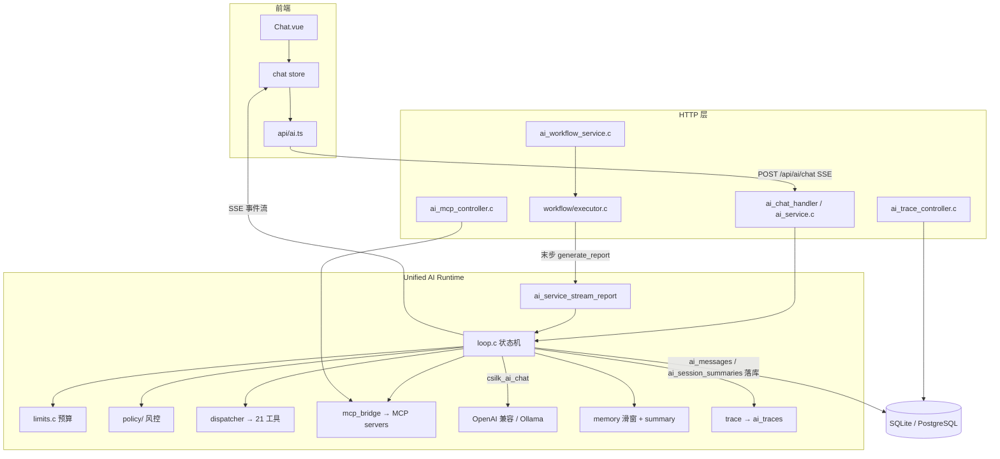

# Minefolio AI 功能全景分析与行动清单

> 分析日期：2026-10-27 ｜ 范围：`backend/src/services/ai/`（约 15.7k 行）＋ `services/ai_service.c` / `ai_workflow_service.c` ＋ `interfaces/http/controllers/{ai,ai_mcp,ai_trace}_controller.c` ＋ `frontend/src` AI 面 ＋ 测试矩阵
>
> 方法：10 个只读分片侦察（运行时核心 / 工具 / 策略 / 模型层 / 工作流 / 记忆 / 追踪 / MCP / 前端 / 测试）逐文件梳理，全部论断附 `file:line`；标注 `[INFERENCE]` 的结论为静态推导未运行验证。关键项（错误码区间、预算默认值、permissions 位图、确认不阻断、`model/` 死代码、stats 字段截留）已二次抽查源码证实。
>
> 关联文档：`docs/ai-runtime-architecture.md`（架构规范，注意其中错误码/预算数值/工作流数量已过时，见 §9 文档漂移）、`docs/design/MCP_SUPPORT_DESIGN.md`。

---

## 1. 功能全景

| 面向 | 能力 | 入口 / 证据 |
|------|------|------------|
| 对话 | 流式聊天、深度思考卡、工具调用卡、用量统计（tokens/$/耗时）、错误条+重试、编辑重发、重新生成、多会话管理（搜索/分组/重命名/导出） | `/chat`；`Chat.vue:196-300`、`chat.ts` |
| Agent | 21 个内置工具（只读查询 + propose/confirm 记账写路径）、MCP 远端工具动态并入 | 对话内自动调度；`tools/registry.c:29-42` |
| 工作流 | 13 个一键财务报告（月末复盘/组合再平衡/消费决策/工资分配/预算预警/异常检测/订阅审计/应急基金/目标追踪/债务规划/现金流预测/账单日历/健康分） | 胶囊栏 + 斜杠菜单；`workflow/engine.c:18-35` |
| 分析 | AnalysisPanel 分段抽取（mermaid/wf-config/wf-progress/action/表格）、Mermaid 渲染（明暗主题） | `chat-panel-extractor.ts:9-41`、`MermaidBlock.vue` |
| 可观测 | Trace 列表（provider/model 过滤/统计卡）+ 详情抽屉（Bento 指标、TTFT、tok/s、成本、消息查看器） | `/ai-traces`；`AiTraces.vue`、`AiTraceDetail.vue` |
| 集成 | MCP server CRUD/refresh/脚本上传；对外 `/mcp` JSON-RPC 端点（面向 Claude Desktop/Cursor 等外部客户端）；AI 设置（provider/model/key/启停） | 设置页 `AiMcpManager.vue` |
| 移动端 | **无 AI 入口**（`router/mobile.ts` 仅 8 个财务路由；`views-mobile/` 无 chat/trace） | `AiFrontend` 分片证实 |

## 2. 架构与请求流



单次聊天生命周期（`ai_service.c:519-743` → `loop.c:318-699`）：
鉴权 → body 解析（session_id/content/model/provider/regenerate/truncate_from_id/temperature/max_tokens/top_p/enable_thinking）→ provider/model 解析（回落 default_provider / `prov.models[0]`）→ 会话校验或新建 → regenerate 删尾 assistant / truncate_from_id 截断（**必须在载入历史之前**）→ 载入历史窗口 → 落 user 消息取真实 id → `ai_memory_build_messages`（system → 摘要 system → 滑窗历史 → 本轮 user）→ `csilk_sse_init` → 回传 `user_message_id` → 进入 loop：

```
每轮: 预算检查(pre-turn) → 构建请求 → csilk_ai_chat(流式)
      → 记账(token/cost) → 取消检查 → 错误分类
      → 无工具调用: 落库 assistant → done(OK)
      → 有工具调用: tool 预算检查 → 追加 assistant(tool_calls)
        → 逐工具: policy → 去重 → 执行 → 记录 span → 追加 tool 消息 → 下一轮
终态: trace 结算保存 → done(OK) 或 error(code)
```

## 3. 运行时硬化机制（当前实现）

| 机制 | 说明 | 位置 |
|------|------|------|
| 协作取消 | 任一 SSE 写失败置位 `cancel_token`（含 15s 静默心跳探测）；逐 chunk / 每轮 / 模型返回后 / MCP 执行前检查；取消后保留已流出正文 | `ai_service.c:242-250`、`loop.c:181-190,385-392` |
| 双层重试 | csilk 内建（仅 CURL/429/502/503，1s/2s 退避）＋ Runtime 兜底（0.5s/1.5s，仅本轮未流出正文且非 4xx 配置类错误） | `deps/csilk …/ai.c:364-392`、`loop.c:360-376` |
| 预算收敛 | TIMEOUT/TOOL/CONTEXT_OVERFLOW 且未取消时追加 `tool_choice="none"` 收尾调用，成功则 `finish_reason="budget"` 落库出真实答复 | `loop.c:589-647` |
| 同参去重 | FNV-1a64(name+args) 64 槽，命中回放 `duplicate_call` 不执行不计 tool budget；对 args 文本格式差异敏感（空白/键序不同即绕过） | `loop.c:95-133,510-528` |
| 工具结果截断 | 喂模型单条 >8192B → `{"truncated":true,…,preview:前8KB}`（UTF-8 边界）；SSE/落库仍完整 | `loop.c:97,135-163` |
| 部分持久化 | 断流/超时轮次的 accumulated/thinking 落库，无正文占位 `[思考已中断]` | `loop.c:649-674` |

## 4. 预算与限额（默认值，`limits.c:4-14` 已核实）

| 配额 | 默认 | 检查点 | 违规错误 |
|------|------|--------|---------|
| max_iterations | 10 | 轮首 | TIMEOUT(1004) |
| timeout_ms | **0（不限）** | 轮首 | TIMEOUT |
| token_budget | 32768（累计口径） | 轮首 | CONTEXT_OVERFLOW(1005) |
| tool_budget | 15 | 追加 assistant 前（前瞻 used+requested） | TOOL(1002) |
| cost_budget | $0.50（按硬编码价折算） | 轮首 | CONTEXT_OVERFLOW |

注意：检查为**轮首**（pre-turn）——单次模型调用可击穿 token/cost 上限；收敛调用不受预算与取消保护。

## 5. SSE 协议与错误码

| event | payload | 出处 |
|-------|---------|------|
| `delta` / `thinking` | `{content,timestamp,time}` | `ai_service.c:322,400` |
| `tool_call` | `{id,name,arguments}` | `:428` |
| `tool_result` | `{tool_call_id,name,result}` | `:434-456` |
| `user_message_id` / `assistant_message_id` | `{"id":"<int 字符串>"}` | `:513-515,711-716` |
| `done` | `{finish_reason,prompt_tokens,completion_tokens,total_tokens,cost_usd,elapsed_ms,iterations,tool_calls}` | `:159-181` |
| `error` | `{code,message}`（message 经 `format_friendly_error`） | `:184-221` |
| keepalive | 静默 ≥15s 空注释帧 | `:274,352` |

错误码（`runtime/error.h`，**实际值为 1001-1007**）：MODEL=1001、TOOL=1002、POLICY=1003（**死枚举，运行时不抛**——策略拒绝以 tool_result 文本回灌）、TIMEOUT=1004、CONTEXT_OVERFLOW=1005、VALIDATION=1006、CANCELLED=1007。

## 6. 工具清单（21 个内置）

只读 17：`get_assets`（支持 `account_id` 过滤）、`get_asset_detail`、`get_asset_breakdown`、`get_transactions`、`get_expense_trend`、`get_daily_expenses`、`get_expense_by_category`、`get_summary`、`get_categories`、`get_exchange_rate`、`analyze_financial_health`、`calculate_compound_interest`、`calculate_loan_repayment`、`get_current_time`、`calculate_date_range`、`web_search`、`fetch_webpage`。
写路径 4（两步确认）：`propose_daily_expense` → `confirm_proposed_expense`；`propose_transfer` → `confirm_proposed_transfer`。

调度链（`tools/dispatcher.c:12-220`）：user_id 校验 → mcp 前缀路由 → 查找 → required 校验 → policy → execute → audit。**注意**：schema 的 properties 类型/enum 校验为空壳（仅 required 生效）；`tool->validate` 钩子全部为 NULL；审计 stage 靠工具名前缀判定；`get_*` 类工具（含 `get_asset_breakdown`/`get_summary`）以 page_size 100-200 循环全量拉取，>200 资产静默漏计。

MCP 工具以 `mcp:<serverId>:<tool>` 命名并入同一 dispatch 面（见 §8）。

## 7. 工作流（13 个，实为线性图非 DAG）

| # | id | 用途 | LLM |
|---|----|------|-----|
| 1 | wf_monthly_review | 月末财务深度复盘（4 节点） | 末步 |
| 2 | wf_portfolio_rebalance | 投资组合再平衡 | 末步 |
| 3 | wf_expense_decision | 大额消费决策（params.amount） | 末步 |
| 4 | wf_payday_split | 工资到账分配（params.month） | 末步 |
| 5 | wf_budget_guard | 预算超支预警（params.month） | 末步 |
| 6 | wf_anomaly_detect | 异常交易/重复扣款 | 末步 |
| 7 | wf_subscription_audit | 订阅与固定开销审计 | 末步 |
| 8 | wf_emergency_fund | 应急基金检查 | 末步 |
| 9 | wf_goal_tracker | 储蓄目标追踪 | 末步 |
| 10 | wf_debt_payoff | 债务加速偿还（雪崩/雪球） | 末步 |
| 11 | wf_cashflow_forecast | 现金流滚动预测 | 末步 |
| 12 | wf_bill_calendar | 账单日历/高压日 | 末步 |
| 13 | wf_health_score | 财务健康分（四维雷达） | 末步 |

执行：`POST /api/ai/workflows/run` → 逐节点确定性计算（只读 `mf_ai_repo_*`，**不经 policy**）→ 末步 `ai_service_stream_report` 走 LLM（可调工具、受 policy；失败回退确定性报告 64B 分块）。前端 `DIRECT_RUN_IDS={portfolio_rebalance,goal_tracker,bill_calendar,health_score}` 直跑，其余先配置卡。已知问题：前端配置卡 6 类参数后端仅读 2 类（month/amount，其余静默忽略）；确定性节点无 cancel 检查；用户消息不落库（无 message-id 事件）；`step_progress` 事件前端丢弃。

## 8. MCP 子系统

- **transport**：HTTP（libcurl 短连接 + `Mcp-Session-Id`）与 STDIO（fork+execve、换行分帧）；stdio 池 64 槽/逻辑上限 16（`MINEFOLIO_MCP_STDIO_MAX_PROCS`）。
- **发现**：`/test` 与 `/refresh` 同一实现——initialize → tools/list → 事务全量 upsert（`mcp_server_tool`，schema >16384 降级 `{}`；mutation 按关键词启发式判定，risk 仅 low/medium 二值）。
- **执行**：dispatcher 前缀路由 → 归属校验 → policy（缓存的 risk 作 override）→ MCP 限频 30/分 → stdio acquire / HTTP 短连 → `tools/call` → 结果取 `content[0].text`。
- **管理 API**：servers CRUD/`/:id/tools`/`/:id/test`/`/:id/refresh`；`scripts` 上传（≤5MB，仅 .py/.js/.mjs/.sh，存 `./data/mcp_scripts/<uid>/`，可作为 stdio command）。
- **对外 `/mcp`**：JSON-RPC（initialize/tools/list/tools/call），JWT + 120/分限频，走内置 dispatcher 含 policy/audit。
- **安全**：SSRF 仅保存时文本校验（无 DNS 二次解析；十进制/十六进制 IP 与部分 IPv6 形式可绕过）；`MINEFOLIO_MCP_ALLOW_LOCAL=0` 默认；command 黑名单式（禁 `; & | \` $ > <`，无解释器允许列表）；**policy 权限层对 `mcp:` 前缀恒判 READ**。

## 9. 关键缺陷与文档漂移

### 9.1 安全主线断点（已抽查证实）

| # | 缺陷 | 证据 |
|---|------|------|
| S1 | `/api/settings/ai` GET/PUT、`/test`、`/fetch-models` 仅校验登录——任意用户可改写全局 AI 配置（含 API key）；test/fetch-models 接受任意 base_url+key 且未过 `mf_ai_rule_validate_url`（内网探测面） | `ai_controller.c:211,229,254,260`、`ai_service.c:855-1015` |
| S2 | 确认机制不阻断：loop 仅拦 `!allowed`，`requires_confirmation=true` 照常执行；`decision->draft` 永不赋值 → `confirmation_required` SSE 分支死代码 | `loop.c:497-505`、`policy.c` 无 draft 写入 |
| S3 | 前端旁路：ActionCard 解析模型文本里的 ```action JSON 后直调 REST 写库，绕过 policy/确认/审计（模型文本无服务端签名） | `ActionCard.vue:334-378` |
| S4 | 权限默认全开：任意已认证用户默认 `ADMIN`；工具 ctx `permissions=0xFFFFFFFF`；无角色配置入口 | `permission.c:63-65`、`tools/context.c:29` |
| S5 | 频次双计：每次工具调用计 2 次（loop + dispatcher/bridge）→ 有效 30/分；风险判定走工具名 pattern，registry 声明的 risk 仅进审计 | `loop.c:486` + `dispatcher.c:143` |

实际生效的 propose→confirm HMAC 令牌（恒时比较/重放 nonce/参数哈希绑定/300s TTL）本身实现扎实（12 个单测段），但**未被前端消费**，且整条链无端到端测试。

### 9.2 资源与稳定性

- 聊天模型调用**无 HTTP 超时**（`loop.c:340-352` 未设 timeout_ms）且同步 curl 跑在事件循环线程——上游挂起即阻塞服务。
- 摘要为 detached pthread，与 SSE 主线程共用 csilk **单连接** sqlite 池（无锁）——并发读写种族风险；摘要 token/成本不计入 stats/cost_budget。
- `ai_traces` 无任何清理/保留策略；`session_id` 无索引；会话删除 vs FK（无 CASCADE）可能导致 "删有 trace 的会话报 1003" `[INFERENCE]`；`tool_spans[3072]` 固定缓冲静默丢弃超额跨度；`/stats` 仅返回 4 字段（repo 已算 tai/s tok/s/总成本被 usecase 丢弃）。
- MCP stdio：`evict_idle/shutdown` 无生产调用点（空闲不回收、退出不 kill）→ 孤儿进程；scripts 上传 >5MB 丢块截断。
- 取消不覆盖内置工具：`web_search`/`fetch_webpage`（含 curl）不检查 cancel_token，用户取消后仍跑完。

### 9.3 死代码（零调用方，建议清理）

`services/ai/model/` 全目录（request/response/provider/model.c，且不解析 reasoning/tool 流式——与实际链路口径不一致）；`trace/exporter.c`；`trace/span.c`（未启用的独立抽象）；`report_tool.c:129` web_search stub（被同名注册静默覆盖）；`workflow/graph.c`、`node.c`（3 行空壳）；`ai_workflow_service.h` legacy `ai_workflow_def_t`；`ai_confirmation_draft_create`。

### 9.4 文档漂移（`docs/ai-runtime-architecture.md` vs 代码）

| 文档声称 | 实际 |
|---|---|
| 错误码 1-7 | 1001-1007 |
| timeout 120s / tool_budget 20 / cost $1.00 | 0（不限）/ 15 / $0.50 |
| 确认令牌"带 Nonce 防重放的双重确认"生效 | policy 草案路径死代码，仅工具自包含 token 生效 |
| workflow 目录 3 个内置模板 | 独立 `workflows/` 13 个实现 |
| 5 级风控可阻断执行 | 等级不阻断（仅金额/频次/权限阻断） |

## 10. 测试覆盖矩阵

| 功能域 | 套件 | 规模 |
|--------|------|------|
| chat + 工具调用回归 | `test_ai_tool_call.sh` | 15 |
| 编辑重发截断 | `test_ai_truncate.sh` | 14 |
| 循环硬化（重试/收敛/去重/断流） | `test_ai_loop_hardening.sh` | 20 |
| Trace 读取链路 | `test_ai_trace.sh` | 17（sqlite 播种，绕过真实写入路径） |
| MCP 客户端/服务端 | `test_mcp.sh` / `test_mcp_server.sh` | ~15（2 可 SKIP）/ 10 |
| AI 端点（核心套件） | `test_link.sh` case 34-37 | ~26/169 |
| policy/令牌/工具/运行时/摘要 | CTest：test_ai_policy(12)/test_ai_tools(9)/test_ai_runtime(13)/test_ai_summary(1)/test_mcp_pool/test_policy_mcp_risk/test_domain_ai/test_domain_mcp | 8 套 |
| 前端 | 16 spec（chat/thinking/tool-card/trace/mermaid/…) | 64 用例 |

**未覆盖**：确认流端到端（模型触发 mutation → 确认 → 落账）、MCP 远端执行与 scripts、摘要失败/PG 方言、13 工作流中 9 个、后端并发竞态、移动端、桌面/移动双 vitest project、`/api/ai/sessions/:id/messages` 删除。`test_full.sh` 不聚合任何 AI 用例；端口硬编码分散。

## 11. 行动清单

### P0（安全/正确性）

- [ ] **AI 设置端点加 admin 门禁 + SSRF 校验**：`ai_controller.c:211,229,254,260`；`fetch-models`/`test` 走 `mf_ai_rule_validate_url`。验收：非 admin 拒绝；内网 base_url 被拒。
- [ ] **确认机制收口**：(a) loop 对 `requires_confirmation` 阻断（回注确认请求）或接通 draft 流程 `loop.c:497`；(b) ActionCard 写路径改走服务端 propose/confirm（或对 action JSON 加服务端签名校验）`ActionCard.vue:334-378`。验收：新增端到端集成用例（模型触发写 → 确认 → 落账，拒绝路径不落账）。
- [ ] **摘要线程并发安全**：摘要落库与在途 chat 串行化（或等 csilk 池支持多连接）`summary.c:285-291`。验收：长会话压测无 "database is locked"/读脏。
- [ ] **聊天请求设 HTTP 超时**：`loop.c:340-352` 给 `req.timeout_ms` 默认值（如 120s）。验收：挂起的上游在超时后返回 error(1004)。

### P1（稳定性/一致性）

- [ ] 取消传播到内置工具（web_search/fetch_webpage 检查 cancel_token）。
- [ ] 定价可配置：`ai.json` 增加价格字段，替换 `loop.c:379-380` 与 `common/ai_trace.c:274-288` 两处硬编码；`cost_usd`/预算语义随真值校正。
- [ ] `ai_traces` 治理：V018 迁移加 `session_id` 索引与 FK CASCADE（或 SET NULL）+ 清理策略（保留 N 天/条）；`/stats` 补 `avg_tokens_per_sec`/`total_cost_usd`（`usecases.c:565`）。
- [ ] MCP stdio 生命周期：接线 `evict_idle`（空闲 TTL）与 `shutdown`（atexit/PDEATHSIG）；`scripts` 上传分块修复。
- [ ] 频次去双计（loop/dispatcher 保留一处）+ `permission.c:63` 默认角色降为 VIEWER/STANDARD。
- [ ] 工作流：接通 6 类前端参数（lookback/target_months/horizon/比例）；确定性节点加 cancel 检查；用户消息与 message-id 落库；`step_progress` 前端消费。
- [ ] MCP tools/list 字段校验（缺 name 不入库）；`is_mutation` 关键词表扩充（send/publish/pay/transfer→high）。

### P2（清理/体验）

- [ ] 死代码清理：`model/` 全目录、`exporter.c`、`span.c`、`report_tool.c` stub、`graph.c/node.c`、legacy def、`ai_confirmation_draft_create`（与 §9.3 一致，同步更新 CMake 源列表）。
- [ ] 文档同步：修正 `ai-runtime-architecture.md` 错误码/预算/工作流数/目录树；`architecture.md:329,1255` 工作流计数。
- [ ] 前端：错误 `chunk.code` 分型消费（401/超时/审查）；usage 与会话历史一起持久化（或明确"仅当次"）；`DIRECT_RUN_IDS` 单一来源；SmoothStreamWriter 死挂载清理；输入 maxlength 与流式期可编辑。
- [ ] 测试补齐：确认流 E2E；MCP scripts/远端鉴权；13 工作流全量节点断言；桌面+移动双 vitest project；端口随机化；`test_full.sh` 聚合 AI 套件。

---

## 附录：主要参考文件

| 主题 | 文件 |
|------|------|
| 循环状态机 | `backend/src/services/ai/runtime/loop.c` |
| 预算/错误码 | `runtime/limits.c`、`runtime/error.h` |
| 聊天 SSE 服务 | `backend/src/services/ai_service.c` |
| 工具注册/调度 | `tools/registry.c`、`tools/dispatcher.c` |
| 策略/确认/审计 | `policy/policy.c`、`policy/confirmation.c`、`policy/permission.c`、`policy/audit.c` |
| 工作流引擎/实现 | `workflow/engine.c`、`workflow/executor.c`、`workflows/*.c` |
| 记忆/摘要 | `memory/memory.c`、`memory/summary.c` |
| 追踪 | `common/ai_trace.c`、`infrastructure/repositories/ai_trace_repo_impl.c` |
| MCP | `tools/mcp/mcp_bridge.c`、`tools/mcp/mcp_client.c`、`tools/mcp/mcp_stdio_pool.c`、`ai_mcp_controller.c` |
| 前端 | `frontend/src/stores/chat.ts`、`views/Chat.vue`、`api/ai.ts`、`components/{AnalysisPanel,WorkflowProgressCard,MermaidBlock}.vue` |
