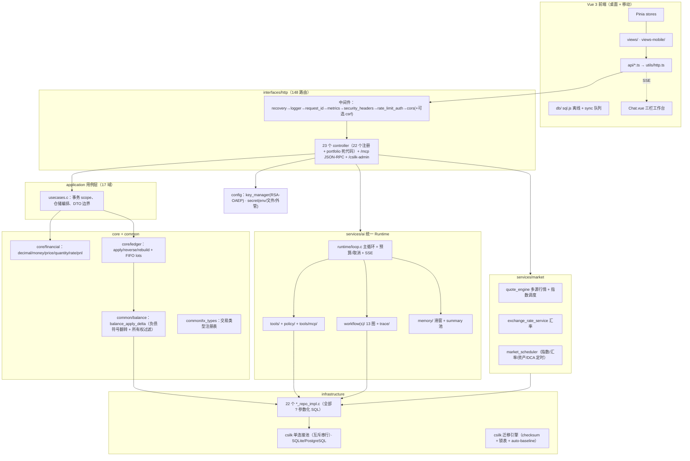

# Minefolio 全量代码分析报告（2026-11-04）

> 方法：13 个只读 scout 并行切片扫描（后端 7 + 前端 2 + 基础设施/构建 2 + HTTP 层 1 + 工作流/trace 1），
> 所有结论带 `file:line`；标注 **[自验]** 的条目由主分析者二次核对过源代码。
> 基线：`master @ b781c243`（工作树 `backend/tests/unit/test_ai_tools.c` 有未提交修改）。

---

## 1. 规模与构成

| 维度 | 数值 | 依据 |
|---|---|---|
| 后端 C 源码 | ~64.3k 行（`src/**/*.{c,h}`），最大文件 `core/ledger/ledger_engine.c` 1340 行 | `find src -name '*.c' -o -name '*.h' \| xargs wc -l` |
| 前端 TS/Vue | ~52.7k 行，其中 `db/generated/sql-wasm-base64.ts` 8.8k 行为生成物；手写约 44k | 同上 |
| HTTP 路由 | **147 条 `/api` + 1 条 `POST /mcp` = 148**（GET 67 / POST 50 / PUT 17 / DELETE 14） | `csilk_app_*_ext` 计数（主分析者实测 145 于 controller 内；HttpLayer 全量口径 148） |
| DDD 领域 | 17 个（tag/category/ledger/daily_expense/transfer/dca/report/file/import-export/auth/ai/market/asset/transaction/portfolio/cashflow/account） | `src/application/*`、`src/domain/*` |
| 仓储实现 | 22 个 `*_repo_impl.c` | `src/infrastructure/repositories/` |
| 数据库迁移 | V001–V021，SQLite/PostgreSQL 双方言各 21 个；schema 快照 32 张表 | `sql/migrations/`、`sql/migration.sql` |
| AI 工具 | 23 个静态注册 + `mcp:<server>:<tool>` 动态；13 个内置工作流 | `services/ai/tools/registry.c`、`workflows/engine.c:19-33` |
| 测试 | 51 个单测文件 / 50 个 CTest 注册；15 个集成脚本 + 5 个 mock 服务 | `backend/tests/`、`CMakeLists.txt` |
| 前端测试 | 37 个 vitest spec | `frontend/tests/` |

---

## 2. 架构总览

### 分层职责与依赖方向

| 层 | 关键点 |
|---|---|
| `main.c` | 181 行：JWT_SECRET 校验（`main.c:63-67`）→ `db_init` + 迁移 → RSA 初始化 → 中间件栈（`main.c:98-130`）→ 22 个 `register_*` → `/csilk-admin` → 静态 SPA → `market_scheduler_start`（2 worker） |
| `interfaces/http/controllers` | 多数为薄代理；例外见 §4-P1-13（admin/receipt/ai_mcp/market 含业务逻辑） |
| `application/*` | 用例编排 + `db_tx_scope_*` 嵌套保存点；21 个域 |
| `domain/*` | 纯规则；`port代理` 无外部依赖 |
| `infrastructure/*` | 22 仓储（全 `?` 参数化）；另有 **mf_db 抽象为死代码**（生产零调用，PG 适配器是 stub，见 §4-P2-3） |

---

## 3. 关键机制速览

### 3.1 金融内核与账本（core）

- `decimal_t` = `__int128` 尾数 + scale≤18（`core/financial/decimal.h:14,50-52`）；256 位精确乘法、长除法、余数驱动舍入（`decimal.c:186-215,241-283,686-729`）。
- 溢出：add/sub/mul/div/round 均有检查；**唯 `decimal_from_parts` 无**（`decimal.c:292-296`）。
- `balance_apply_delta_m`：所有权过滤 `WHERE a.id=? AND a.user_id=?`（`balance.c:53-59`），负债类符号翻转（`balance.c:83-87`），审计写 `asset_balance_logs`。
- 成本基础两套路径：实时 `apply_position_fc` 用 **amount+fee**（`balance.c:250-252`），重建用 **price×qty+fee**（`ledger_engine.c:1089`）→ `amount≠price×qty` 时两态不一致 [未复核，来自 CoreLedger 切片]。
- FIFO/lots：`ledger_calc_sell_position_fifo`（`ledger_engine.c:186-300`）+ `transaction_lot_repo_impl.c`。
- **账本快照链路空转**（见 §4-P0-6）。

### 3.2 交易写路径

- `db_tx_scope_begin`：无事务 `BEGIN TRANSACTION`，有事务则 `SAVEPOINT name_seq`（`deps/csilk/.../tx_scope.c:37-49`）[自验]。
- fee 子行在 `ledger_apply_tx` 内先 INSERT 再扣款（`ledger_engine.c:554-606`）；回滚按 `parent_tx_id` 冲回（`ledger_engine.c:705-734`）。
- transfer 删除：`transfers.from_tx_id/to_tx_id` 优先 → `parent_tx_id` → `(from_asset,to_asset,amount)` 兜底（`application/transaction/usecases.c:455-597`）。

### 3.3 AI Runtime（services/ai）

- 单主循环 `ai_runtime_execute_stream`（`runtime/loop.c:304-1050`）：轮前预算 → `csilk_ai_chat`（≤2 次兜底重试）→ 工具预算 → 并行（仅 `web_search`/`fetch_webpage`）或串行（policy→确认→执行→`role=tool` 回填，结果裁剪 8192B）。
- SSE 事件：`delta / thinking / tool_call / tool_result / user_message_id / assistant_message_id / done / error`（`ai_service.c:189-725` 段）+ 工作流的 `workflow_*` 系列。
- 预算（`runtime/limits.c:5-13`）：iterations=10、token=32768、tool=15、cost=$0.50、**timeout=0=禁用**。
- 确认令牌：`mf_v2`（HMAC-SHA256，参数哈希排序、常量时间比对）+ `mf_batch_v1`；nonce 持久化于 `ai_consumed_nonces`（V019）。
- 工具 dispatch 单入口 `ai_tool_dispatch_parsed`（`tools/dispatcher.c:9`）。

### 3.4 认证与安全

- 8 条 JWT 白名单（`middlewares/jwt_middleware.c:120-128`）[自验]。
- JWT：HS256，`sub/iat/exp(7d)/v`，`v` 与 DB `token_version` 比对（5s 进程内缓存）。
- RBAC：`ctx_ledger_id(c,uid,role)` 统一入口（`common/ctx.h:77-140`），角色 owner/editor/viewer。

### 3.5 数据层

- 生产唯一路径：csilk 全局单连接池（`db_internal.h:20-24`：driver + connection + mutex）[自验]，**参数为字符串转义拼接**而非真正绑定（`deps/csilk/src/drivers/db/db.c:391-460`）[自验]。
- 迁移引擎（csilk）：checksum=CRLF 归一化 SHA-256、`schema_migration_lock` 分布式锁、auto-baseline ≤V007。

### 3.6 前端

- 桌面：`views/` 19 页 + `components/` 96 个 Vue 文件；SSE 手写解析（`api/ai.ts:307-370`）+ typewriter + Mermaid + 分析面板。
- 移动：`views-mobile/` 11 视图；sql.js WASM（base64 内嵌 902KB）+ `sync_queue` 双向同步。

---

## 4. 缺陷清单

> 验证级别：**[自验]** = 主分析者已核对源码；**[切片]** = scout 报告（带 file:line，未逐条复核）。

### P0 — 安全 / 数据正确性（建议立即修复）

| # | 问题 | 证据 | 验证 |
|---|---|---|---|
| 1 | **MCP stdio 池悬垂指针（UAF）**：`mcp_bridge.c:493` 的栈上 `mf_mcp_server_t server` 被交给池复用客户端，`mcp_client_new` 只存指针不拷贝；池跨请求复用后读取已销毁栈帧 | `mcp_bridge.c:493,588` → `mcp_stdio_pool.c:144` → `mcp_client.h:33`、`mcp_client.c:779`，使用点 `mcp_client.c:653,854,1091` | **[自验]** |
| 2 | **OAuth 回调可被任意冒用**：回调不做 provider 侧 code 交换，直接信任客户端 `oauth_id`，命中即签发 7 天 JWT；该路由在 JWT 白名单内 | `application/auth/usecases.c:645-738`（:665-670, 682-690, 720）；`jwt_middleware.c:127` | **[自验]** |
| 3 | **TOTP 2FA 可绕过**：登录 `temp_token` 与正式 token 同构（同 sub/v/7 天、无待二步声明），可直接当 Bearer 使用 | `application/auth/usecases.c:203-210,218`；`common/jwt.c:37-52`；`jwt_middleware.c:163-215` | **[自验]** |
| 4 | **`/csilk-admin/*` 完全无鉴权**：以 `NULL` 中间件注册（stats/ws/topology/flamegraph/profile 全公开），nginx 一并公开代理 | `main.c:155`；`deps/csilk/src/app/admin.c:375-380`；`nginx/minefolio.docker.conf` | **[自验]** |
| 5 | **MCP stdio 任意命令执行**：`command` 仅过滤 7 个 shell 元字符，`args_json` 零过滤直接进 argv；任意已认证用户可配置 stdio server（以服务进程身份执行，可读全库） | `domain/mcp/rules.c:142-160`；`mcp_client.c:400-470`；`application/mcp/usecases.c:26-63` | **[自验]** |
| 6 | **账本快照链路死代码**：`ledger_snapshot_save` 无任何生产调用者（仅单测），引擎只读不写 → `had_snapshot` 恒 false，V020 宣称的「增量重建 / 级联失效」实际全部空转，每次重建都是 O(n) 全量重放 | `ledger_snapshot_repo_impl.c:66`（调用者仅 `tests/unit/*`）；`ledger_engine.c:1012-1014`；`lots_snapshot_json` 只写不读 | **[自验]** |
| 7 | **全局单连接 + 2 worker + 连接级事务状态**：事务状态不属于线程；B 线程语句可落入 A 未提交事务并被联合回滚；`BEGIN TRANSACTION` 非 IMMEDIATE | `deps/csilk/.../db_internal.h:20-24`、`db.c:168-170,244-246`、`tx_scope.c:44-49`；`main.c:78`（2 workers） | **[自验]**（隔离性缺陷成立；实际触发依赖调度） |
| 8 | **AI 工具权限/风险闸形同虚设**：`ctx->permissions` 恒 `0xFFFFFFFF` 使 `mcp_bridge` 权限检查恒真；policy 对 `mcp:` 前缀按 READ/LOW 判级；loop 的确认闸不覆盖 MCP medium 写工具 | `services/ai/tools/context.c:29`；`mcp_bridge.c:537`；`policy/permission.c:20-31`、`risk.c:33-77`；`loop.c:814` | **[自验]**（context.c:29、loop.c 段） |

### P1 — 功能/可靠性缺陷

| # | 问题 | 证据 | 验证 |
|---|---|---|---|
| 9 | **移动端离线 ID 重映射断裂**：`assets`/`daily_expenses` create 返回 `data:null`（`respond_ok_null`），前端 `res?.id` 取不到 → 占位 ID 永不重映射，update/delete 恒冲突、pull 又插重复行 | `asset_controller.c:82`、`daily_expense_controller.c:145`；`frontend/src/stores/sync.ts:227-240`、`offline-http.ts:110-133` | **[自验]** |
| 10 | **时点汇率（V020）只写不读**：`fx_rate_to_cny` 全仓仅 2 处 UPDATE，无任何读取；资产趋势仍用当前汇率，历史估值仍随汇率漂移（与 CHANGELOG/README 宣称相反） | `application/transaction/usecases.c:150,332`；`report_asset_service.c:179`；`portfolio_repo_impl.c:446-448` | **[自验]** |
| 11 | **AI 请求超参不生效**：`temperature/top_p/max_tokens` 从未写入请求体；执行超时 `timeout_ms` 默认 0 且两个调用方都不设置 | `runtime/loop.c:491-503`；`deps/csilk/src/drivers/ai/openai.c:478-492`；`runtime/limits.c:11` | **[自验]** |
| 12 | **工作流取消无效 + 末步失败静默成功**：executor 无 cancel 入口（`ai_workflow_service.c:64` 调用者不传任何取消源，`ctx->cancel_token` 恒 NULL）；LLM 末步失败回退后即使回退节点也失败仍发 `workflow_complete` | `workflow/executor.c:62,88-99,126-177`；`workflow/context.c:8-18`；`services/ai_workflow_service.c:64` | **[自验]**（cancel 链路） |
| 13 | 交易写路径问题：fee 子行 INSERT 失败被静默忽略；DCA 可重复确认双买（pending 检查在事务外、UPDATE 无 user/status 条件）；transfer 属性兜底 `LIMIT 1` 同额多笔误删；非投资资产 buy/sell 静默 no-op 但按投资分支处理 | `ledger_engine.c:588-591`；`dca/usecases.c:206-210,286-287`、`dca_repo_impl.c:431-433`；`transaction/usecases.c:559,573`；`balance.c:224-228`、`ledger_engine.c:490,618-648` | **[切片]** |
| 14 | 限流与准入：`rate_limit_auth` 按 `getpeername` 取 IP（反代后全体共享配额）；`/mcp` 未认证请求不限流；注册永久开放（`mf_auth_rule_can_register` 无调用点） | `middlewares/rate_limit.c:20-34,88-152,221-243`；`domain/auth/rules.c:55-63` | **[切片]** |
| 15 | RBAC 绕过：邀请码对含 viewer 的全体成员可见（可自行引入 editor）；owner 可自我降级致账本永久无 owner；tag/import_rule/receipt 无账本成员校验 | `application/ledger/usecases.c:47,70-82,319-332,444-458`；`tag_controller.c:13` | **[切片]** |
| 16 | 行情：全局设置（代理/自动同步/间隔）任意登录用户可改且无 user 维度；TLS 校验全关；指数闭市失败写死预设价并伪造 OHLC | `market_controller.c:130-205`（**[自验]** 无鉴权判断）；`quote_engine.c:80-81`（**[自验]**）；`quote_engine.c:546-596` | 部分自验 |
| 17 | 报表双口径：持仓浮盈取 `assets.cost_basis` 快照，realized 取账本重放；行情/开仓旁路写不写 `asset_balance_logs` 也不重放 → 两源可永久分叉；支出/资产报表仍 double 累加（128 位仅窄路径） | `domain/portfolio/rules.c:130` vs `:34-36,67-69`；`asset_repo_impl.c:333-374,399-423`；`report_expense_service.c:91…` | **[切片]** |
| 18 | 前端：`Chat.vue` 2335 行、`chat.ts` 1139 行且 SSE 消费逻辑重复 4 份；`market` store 无 logout reset；部分页面缺 loading/`Promise.allSettled` | `Chat.vue:1-2335`；`stores/chat.ts:638-678` 等；`stores/market.ts:9-11` | **[切片]** |
| 19 | 移动端同步：`conflict` 标志无消费方（"待同步"永不清零）；pull 覆盖不判 pending；写失败（含 1002/1003 业务拒绝）统一按离线入队；整库 base64 存 localStorage 无配额降级 | `sync.ts:126-130,282-288`；`offline-http.ts:118-133`；`db/local.ts:103-112` | **[切片]** |
| 20 | 构建/CI：CI 从不运行 CTest（仅 build + 8 个集成脚本）；`test_portfolio_pnl_alignment` 只编译未注册；7/15 集成脚本不在 CI；无 `-Werror`、无覆盖率、无 CI sanitizer；csilk 依赖取 `master` 不锁版本 | `.github/workflows/ci.yml`（**[自验]** 无 `ctest`）；`CMakeLists.txt:324-331`（**[自验]** 无 `add_test`） | **[自验]** |

### P2 — 死代码 / 一致性 / 文档漂移

| # | 问题 | 证据 |
|---|---|---|
| 21 | 死模块：`services/ai/model/*`（自引用零外部调用）、`runtime/session.c`、`trace/span.*`、`mf_db` 抽象（PG 适配器 `stmt_execute` 不落库/`stmt_query` 恒空 → PG 单测假阳性）、`register_portfolio_routes`（3 条路径与 report_controller 重复）、`mock_openai_server.js` | `ai/model/*`（**[自验]** 仅自引用）；`portfolio_controller.c:97` vs `main.c:142`（**[自验]** 无调用者）；`postgres_adapter.c:413-447` |
| 22 | `tx_types` 词典不一致：引擎 `to_str` 产出 `withdraw/dividend/tax/adjustment`，注册表只有 `withdrawal` 且缺后三者 → lookup NULL → 零 delta。**当前生产 4 个调用点均显式传 `type_str`，属潜伏风险** | `ledger_engine.c:59-86`；`tx_types.c:9-20,36-44`（**[自验]** 全链路） |
| 23 | 错误码语义污染：`1004` 同时表示"已存在/越权/限流/413"；约 40 处 `respond_error(c,500,…)`；JWT 中间件 401 裸 `{"error":…}` 与 HTTP200+1001 双轨 | `common/ctx.h:139`；`rate_limit.c:130-135`；`asset_controller.c:34` |
| 24 | 文档漂移：AGENTS/README 称 V001–V020（实际 V021）；README 称"五级风控"与完整时点汇率（实际见 P0-6/P1-10）；AGENTS 称 CSV blob 走 `axios.get` 例外（实现为 `http.get+responseType`）；`docs/architecture.md` 测试数自相矛盾（35 vs 50）；`test_link_nocleanup.sh` 注释称端口硬编码 8080（已支持 PORT） | 各文件对应行 |
| 25 | 资源/健壮性：trace 明文存输入/输出且默认无限增长；MCP HTTP 响应体无上限 realloc；stdio 子进程继承全量 environ（含 JWT_SECRET）；审计仅内存环无持久化；SSE bridge arena 对 >4KB 分块只增不减 | `ai_trace_repo_impl.c:87-118,180-215`；`mcp_client.c:60-75,632-660`；`audit.c:8-63`；`ai_service.c:322-327` |

---

## 5. 测试与 CI 覆盖

| 层 | 现状 | 缺口 |
|---|---|---|
| CTest 单测 | 50 套件注册（financial/ledger/domain/AI/MCP/迁移）；本地 `ctest` 全绿 | **CI 不运行**；仓库/用例层几乎无直测；market 驱动、中间件无单测 |
| 集成脚本 | 15 个（test_link 174 断言、test_full≈139 检查等）；CI 执行 8 个 | `test_full`、`test_ai_truncate`、`test_ai_loop_hardening`、`test_mcp*`、`test_report_isolation` 不在 CI |
| 前端 | 37 个 vitest spec；CI 运行 `npm test` | 桌面视图级（Assets/Holdings/Categories 加载态）无测 |
| Sanitizer | `MINEFOLIO_SANITIZE`（ASan+UBSan）本地可选 | CI 未启用；无 TSan（并发问题正是 P0-7 所在领域） |
| 部署 | Docker 单镜像 smoke | 无 compose e2e、无镜像漏洞扫描、PG 路径无 CI 验证 |

---

## 6. 行动清单（按优先级）

- [ ] **P0-2/P0-3**：OAuth 回调实现 provider code 交换（或移除该登录方式）；签发独立的 `2fa_pending` 声明并在中间件强制校验。
- [ ] **P0-4**：`csilk_admin_serve_secure` 传入 JWT/管理员中间件；nginx 层同步收口 `/csilk-admin`。
- [ ] **P0-1**：`mf_mcp_client_t` 内嵌 server 配置副本（或池内按 server_id 重新查库），消除悬垂指针。
- [ ] **P0-5**：stdio `args_json` 白名单/长度校验；stdio server 仅管理员可配；子进程降权（rlimit/无 DB env）。
- [ ] **P0-6**：在重建/查询路径写回快照（或删除 V020 死代码并修订文档，二选一）。
- [ ] **P0-7**：收敛单连接 + 多 worker 的事务互斥：处理器级事务锁，或 `BEGIN IMMEDIATE` + 线程绑定校验。
- [ ] **P0-8**：`ctx->permissions` 由真实角色推导；`mcp:` 工具按 mutation 进确认闸。
- [ ] **P1-9**：`asset_usecase_create`/`daily_expense_usecase_create` 返回 `{id}`（与 accounts/transactions 对齐）。
- [ ] **P1-10/11/12**：读取 `fx_rate_to_cny` 或者撤下相关宣称；补发 temperature/max_tokens/timeout；工作流接入取消与预算。
- [ ] **CI**：纳入 `ctest` 与全部集成脚本；注册 `test_portfolio_pnl_alignment`；启用 ASan/TSan 作业；`-Werror`（分阶段）。
- [ ] **清理**：删除 §P2-21 死代码；统一 1004/500 错误码语义；更新 AGENTS/README 漂移条目（V021、fx 语义、blob 例外）。

---

## 附：各切片原始报告索引

`CoreLedger-2`、`AuthSecurity-2`、`TxWritePaths-2`、`AiRuntime-2`、`AiToolsPolicy-2`、`AiWorkflowsTrace-2`、`MarketFx-2`、`ReportsAgg`、`InfraDb`、`HttpLayer`、`FeDesktop`、`FeMobile`、`BuildTestDocs`
（全文可通过 `history://<name>` 检索。）
