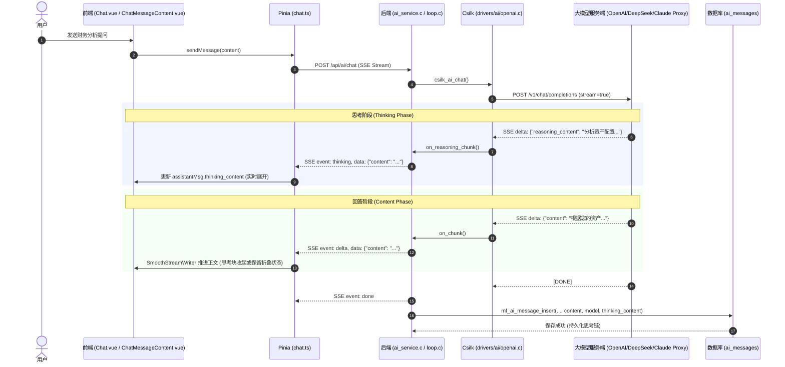

# AI 思考模式 (Thinking / Reasoning Stream & Persistence) 设计文档

## 1. 概述与背景

随着以 OpenAI o1/o3、DeepSeek R1、Claude 3.7 Sonnet 等新一代具备推理链（Reasoning / Extended Thinking）模型的普及，用户在与 Minefolio AI 助手对话时，希望能够直观看到模型的思考推理全过程。

本文档设计并规范了 Minefolio 的思考模式端到端实现：
1. **协议层**：支持 OpenAI 兼容格式下的流式 `reasoning_content`（及 `reasoning` 兼容字段）解析。
2. **后端运行时**：在 `csilk` 驱动层与 Minefolio AI 统一运行时（Unified AI Runtime）中引入思考分块回调，向前端通过 SSE 分发 `event: thinking` 增量事件。
3. **数据持久化**：在 `ai_messages` 表中新增 `thinking_content` 字段并提供双引擎数据库迁移（SQLite + PostgreSQL），确保历史会话重开或重载时完整保留思考记录。
4. **前端交互与呈现**：参考 ChatGPT / Claude 的折叠面板设计，在回复正文上方呈现极简美观的思考过程折叠块，支持流式实时展开打字、思考完毕后平滑收起与按需展开。

---

## 2. 总体架构与数据流



---

## 3. 详细设计

### 3.1 协议规范与 SSE 格式

当前后端已有的 SSE 事件：
- `event: delta`：模型正文输出增量 `{"content": "...", "timestamp": ..., "time": "..."}`
- `event: tool_call`：模型触发工具调用
- `event: tool_result`：工具执行结果
- `event: done`：生成结束 `{"finish_reason": "stop"}`
- `event: error`：错误通知 `{"message": "..."}`

**新增 SSE 事件**：
- `event: thinking`：模型思考推理增量。格式与 `delta` 保持同构，便于前端统一消费：
  ```text
  event: thinking
  data: {"content":"在分析该资产负债率前...","timestamp":1774145400000,"time":"2026-10-21 10:15:00.123"}
  ```

### 3.2 csilk 驱动层改造 (`deps/csilk`)

1. **接口扩展 (`deps/csilk/include/csilk/drivers/ai.h`)**：
   - 在 `csilk_ai_chat_request_t` 中新增流式推理回调：
     ```c
     typedef void (*csilk_ai_stream_cb)(const char* chunk, void* user_data);
     ...
     typedef struct {
         ...
         csilk_ai_stream_cb  on_chunk;           /**< Callback for text content delta */
         csilk_ai_stream_cb  on_reasoning_chunk; /**< Callback for reasoning/thinking delta */
         ...
     } csilk_ai_chat_request_t;
     ```
   - 在 `csilk_ai_chat_response_t` 中新增堆分配字段：
     ```c
     typedef struct {
         char*                 content;
         char*                 reasoning_content; /**< Generated thinking / reasoning content */
         ...
     } csilk_ai_chat_response_t;
     ```
   - 在 `csilk_ai_chat_response_free` 中 `free(res->reasoning_content)`。

2. **OpenAI 驱动实现 (`deps/csilk/src/drivers/ai/openai.c`)**：
   - **流式解析**：在 `process_stream_line` 的 `choices[0].delta` 处理中：
     - 读取 `delta.reasoning_content`，若为空则回退读取 `delta.reasoning`。
     - 若命中且为非空字符串，追加到 `ctx->res->reasoning_content`，若配置了 `ctx->req->on_reasoning_chunk` 则回调通知。
   - **非流式解析**：在 `resp_root` 的 `choices[0].message` 中读取 `reasoning_content` / `reasoning`，赋值给 `res->reasoning_content = strdup(...)`。
   - **完成校验**：在流式完成检测时，若 `res->reasoning_content` 有值而 `content` 尚未生成，保证不判定为错误。

### 3.3 后端 AI 统一运行时 (`backend/src/services/ai/`)

1. **事件回调定义 (`services/ai/runtime/loop.h`)**：
   - `ai_runtime_callbacks_t` 新增 `on_thinking_chunk`：
     ```c
     typedef struct {
         void (*on_text_chunk)(const char* chunk, void* udata);
         void (*on_thinking_chunk)(const char* chunk, void* udata); /* NEW */
         void (*on_tool_call)(const char* id, const char* name, const char* args_json, void* udata);
         void (*on_tool_result)(const char* id, const char* name, const char* result_json, void* udata);
         void (*on_error)(const ai_runtime_status_t* status, void* udata);
         void (*on_done)(const ai_runtime_stats_t* stats, void* udata);
     } ai_runtime_callbacks_t;
     ```

2. **Agent 循环推进 (`services/ai/runtime/loop.c`)**：
   - `loop_stream_bridge_t` 结构增加 `thinking_accumulated` 动态缓冲数组及长度容量。
   - 实现 `on_reasoning_bridge` 回调，缓冲推理全量文本并分发给 `cbs->on_thinking_chunk`。
   - 在模型单轮结束持久化处（`if (ai_res.tool_call_count == 0)` 及多轮结束兜底处），提取 `final_thinking`，传递给 `mf_ai_message_insert(...)` 进行入库。

3. **HTTP SSE 桥接 (`services/ai_service.c`)**：
   - 实现 `sse_bridge_thinking_chunk`，通过 `csilk_sse_send(b->ctx, "thinking", target_buf)` 发送思考分块。
   - 触发首 Token 耗时打点 `ai_trace_record_first_token(b->trace)`，使 TTFT 指标精确对应到思考开始时刻。

### 3.4 数据库持久化与仓库改造

1. **迁移脚本 (`V015__ai_messages_thinking_content.sql`)**：
   - SQLite (`backend/sql/migrations/sqlite/V015__ai_messages_thinking_content.sql`)：
     ```sql
     -- V015: ai_messages 增加 thinking_content 列存储模型深度思考推理过程
     ALTER TABLE ai_messages ADD COLUMN thinking_content TEXT DEFAULT '';
     ```
   - PostgreSQL (`backend/sql/migrations/postgres/V015__ai_messages_thinking_content.sql`)：
     ```sql
     -- V015: ai_messages 增加 thinking_content 列存储模型深度思考推理过程
     ALTER TABLE ai_messages ADD COLUMN thinking_content TEXT DEFAULT '';
     ```
   - 更新基线建表定义 `backend/sql/migration.sql` 与 `backend/sql/migration_postgres.sql` 中的 `ai_messages`。

2. **仓库实现 (`backend/src/infrastructure/repositories/ai_session_repo_impl.c/.h`)**：
   - `mf_ai_message_insert(..., const char* thinking_content)`：入库包含 `thinking_content`。
   - `mf_ai_message_list`：SQL 查询包含 `thinking_content` 字段并由 `csilk_db_query_param_json` 自动打包为 JSON 字段传回前端。

### 3.5 前端 API 与 Store 改造

1. **类型扩展 (`frontend/src/api/ai.ts`)**：
   ```ts
   export interface AiMessage {
     id: number
     session_id: number
     role: 'user' | 'assistant'
     content: string
     thinking_content?: string /* NEW: 存储持久化的思考过程 */
     model?: string
     created_at: string
     workflowData?: WorkflowRunState
     workflowConfig?: WorkflowConfigState
   }

   export interface ChatStreamChunk {
     type: 'delta' | 'thinking' | 'done' | 'error' /* NEW: 'thinking' */
     content?: string
     finish_reason?: string
     message?: string
   }
   ```
   - `streamChat` 生成器遇到 `currentEvent === 'thinking'` 时产出 `type: 'thinking'` 分块。

2. **Chat Store (`frontend/src/stores/chat.ts`)**：
   - 在 `sendMessage`、`sendQuickMessage`、`regenerateLastMessage` 中：
     ```ts
     if (chunk.type === 'thinking' && chunk.content) {
       if (!assistantMsg.thinking_content) {
         assistantMsg.thinking_content = ''
       }
       assistantMsg.thinking_content += chunk.content
     } else if (chunk.type === 'delta' && chunk.content) {
       writer.push(chunk.content)
     }
     ```

### 3.6 前端 UI 组件设计 (`ChatMessageContent.vue` & `Chat.vue`)

1. **交互形态与展开/收起策略**：
   - **思考中阶段**（`isStreaming && !content && thinkingContent`）：
     - 头部显示：“深度思考中...”带有微动呼吸动效与计时/旋转图标。
     - 内容区默认**实时展开**，用户可以直观看到一行行思维链吐字。
   - **正文开始输出阶段**（`content` 收到第一个字符）：
     - 头部平滑变更为：“已深度思考”，并显示折叠/展开指示图标。
     - 默认自动收起（或保持用户手动切换的状态），保证注意力聚焦在正文答案上。
   - **历史会话/完成状态**：
     - 若消息具有 `thinking_content`，在回答气泡顶部显示极简胶囊卡片。
     - 默认**折叠**，点击头部随时无缝展开查看完整推理过程。
     - 支持一键复制思考内容。

2. **样式风格规范**：
   - 采用主题感知设计，契合 Minefolio 现有的 `--mf-bg-*`、`--mf-text-*` 与 `--mf-primary` CSS 变量。
   - 思考卡片采用淡灰微弱边框背景与浅蓝/浅紫左侧强调条：
     ```css
     .thinking-card {
       margin-bottom: 12px;
       border: 1px solid var(--mf-border-subtle, #e2e8f0);
       border-radius: 8px;
       background: var(--mf-bg-subtle, #f8fafc);
       overflow: hidden;
     }
     .thinking-header {
       display: flex;
       align-items: center;
       justify-content: space-between;
       padding: 8px 12px;
       cursor: pointer;
       font-size: 13px;
       color: var(--mf-text-secondary, #64748b);
       user-select: none;
       transition: background 0.2s ease;
     }
     .thinking-content-body {
       padding: 10px 14px;
       border-top: 1px dashed var(--mf-border-subtle, #e2e8f0);
       font-size: 13px;
       color: var(--mf-text-regular, #475569);
       white-space: pre-wrap;
       line-height: 1.6;
       max-height: 360px;
       overflow-y: auto;
     }
     ```

3. **`Chat.vue` 结构更新**：
   - 修改原先三点跳动的静态占位条件：
     ```vue
     <div v-if="!msg.content && chat.isStreaming && !msg.workflowData && !msg.workflowConfig && !msg.thinking_content" class="message-content thinking">
       <span class="pulse-dot"></span>
       <span class="pulse-dot"></span>
       <span class="pulse-dot"></span>
       <span class="thinking-text">思考中...</span>
     </div>
     ```
   - 将 `:thinking-content="msg.thinking_content"` 传入 `ChatMessageContent`，一旦首个思考 token 抵达，立即进入动态思考块渲染。

---

### 3.7 边界策略与前置关键决策规范

经系统级审查（Builder Check），以下 5 项关键边界策略已在架构与设计层面明确锁定：

1. **Agent 循环多轮工具调用思考链合并**：
   - 在 `loop.c` 的核心循环中，若模型在工具调用前后经历多轮思考，`thinking_accumulated` 采用跨轮次**追加累积**策略（多轮间以换行符分隔），确保用户最终看到决策全流程。
   - 在追加模型中间轮次的 `assistant` 消息给下一次大模型请求（`msgs`）时，**严格剔除** `reasoning_content`，仅保留 `content` 与 `tool_calls`，严格符合 OpenAI/DeepSeek 官方 API 对历史消息格式的合规要求，规避 400 校验异常。

2. **思考耗时呈现策略（前端流式瞬态计时）**：
   - 采用前端流式瞬态高精度计时：在思考阶段（首个正文 Token 到达前），前端根据流式开始时间戳实时展示“深度思考中... (X秒)”，流式结束或正文抵达后静态显示为“已深度思考 (用时 X秒)”；
   - 数据库模式保持精炼，仅通过 `thinking_content TEXT` 承载持久化内容，历史会话重开统一展示极简“已深度思考”折叠面板，避免迁移引入额外冗余列。

3. **中断生成与异常断流容错**：
   - 若用户在思考阶段点击“停止生成”或遇到网络异常，后端检查若已有累积思考内容（`thinking_accumulated[0] != '\0'`），仍将当前阶段思考入库，正文置为 `[思考已中断]`，防止数据丢失；
   - 前端消息操作栏（复制、重新生成）的展示条件扩展为 `v-if="(msg.content || msg.thinking_content) && !chat.isStreaming"`，保证用户对中断消息亦可发起“重新生成”。

4. **记忆上下文窗口（Memory Window）严格隔离**：
   - `mf_ai_message_recent` 和 `ai_memory_build_messages` 维持仅提取 `role` 与 `content`，思考链**不注入**给后续轮次大模型上下文，避免数十倍 Token 膨胀及上下文窗口过早耗尽。

5. **协议格式范围**：
   - 遵循用户指定的“OpenAI 格式”，严格聚焦消费 SSE `choices[0].delta.reasoning_content` 及兼容字段 `delta.reasoning`，不引入针对非标准 `<think>` 正文内联标签的复杂流式状态机。

---

## 4. 影响与回归评估

| 模块 | 影响范围 | 风险评估 | 缓解对策 |
|---|---|---|---|
| `deps/csilk` | AI 驱动 vtable 与响应体字段 | 极低 | 新增字段全为可选或零初始化默认值；现有测试与普通模型完全向后兼容 |
| `ai_messages` 数据库 | 新增列 `thinking_content` | 极低 | 使用 `ALTER TABLE ... ADD COLUMN` 并带默认空字符串，零停机无锁兼容 |
| 历史会话展示 | 加载包含或不包含思考过程的消息 | 零 | 旧消息 `thinking_content` 为 null/空串，前端自动隐藏折叠块，完全无缝 |
| 多模型支持 | 非思考模型（如普通 GPT-4o、旧版模型） | 零 | 不输出 `reasoning_content` 时，不触发思考回调，直接走既有 `content` 流 |

---

## 5. 验收测试标准

1. **单元测试验证**：
   - csilk 驱动单测：测试 mock SSE 输出包含 `reasoning_content` 的 chunk 时，`on_reasoning_chunk` 正确被触发且内容被累计。
   - 运行时单测：验证 `loop` 循环中思考内容正确传递给 `mf_ai_message_insert`。
   - 仓库单测：验证 `mf_ai_message_insert` 和 `mf_ai_message_list` 对 `thinking_content` 的持久化写入与读取。
2. **端到端流式验证**：
   - 配置思考模型（如 Claude 3.7 / DeepSeek R1），向 AI 提问复杂财务问题。
   - 观察控制台/页面：先接收到 `event: thinking` 流式打字；随后思考完毕进入 `event: delta` 正文输出。
3. **折叠与交互验证**：
   - 思考中卡片实时展示展开，正文开始后自动折叠。
   - 点击折叠栏能顺畅切换展开/关闭状态；折叠栏包含复制按钮。
4. **历史持久化重载验证**：
   - 刷新页面或切换会话回到该对话，AI 回复顶部应稳定存在已持久化的“思考过程”折叠块，展开后内容与原始生成完全一致。
