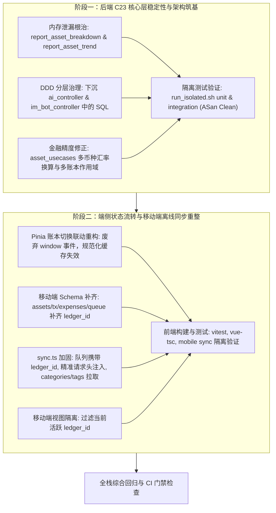

# Minefolio 全面代码审查与存量缺陷重构修复方案 (Design Document)

**文档标识**: `2026-11-19-codebase-refactoring-and-defect-remediation-design`  
**创建时间**: 2026-11-19  
**状态**: 待评审 (Pending Approval)  
**方案策略**: 方案 A（分层解耦与核心契约先行：后端 C23 纯洁度与内存筑基 -> 端侧 Pinia 与离线同步重整）  
**核心约束**: 编译测试必须全程运行在资源隔离环境内，严格限制 cgroups/ASan 内存与并发上限。

---

## 1. 意图与背景 (Intent & Why)

Minefolio 经历了多轮高强度功能迭代（涵盖 17 个 DDD 业务领域迁移、Unified AI Runtime、多账本空间、双引擎迁移、行情调度中心以及移动端 WASM 离线运行）。系统功能齐备且在 CI 中保持全绿，但随着架构深水区的形成，底层积攒了一批不易被常规用例捕获的“隐性存量缺陷”与“架构坏味道”：

1. **后端资源生命周期管理隐患**：
   - 报表聚合服务（`report_asset_breakdown.c`、`report_asset_trend.c` 等）在频繁调用底层 `csilk_db_query_param_json` 时，存在多处未执行 `csilk_json_free` 的内存泄漏点，同时存在 `calloc` 堆结构体未被配对 `free` 的问题。在长时间运行或大规模数据报表查询下会持续侵蚀宿主机 RSS 内存。
2. **DDD 架构边界受损（Controller 泄露 SQL）**：
   - `ai_controller.c`（草稿确认标记）和 `im_bot_controller.c`（读取用户 `token_version`）中直接硬编码了 SQL 语句与 DB 原生调用，违背了项目架构指南中“Controller 仅调用 Usecase/Service、严禁直接执行 SQL”的核心铁律。
3. **多账本数据隔离与金融精度边界缺陷**：
   - `application/asset/usecases.c` 在计算资产组合权重（`portfolio_weight`）时，对多币种资产采取了直接将 `current_value` 裸数值累加的错误做法（例如将 100 USD 与 700 CNY 直接数值相加），未经过汇率折算到账本基础币种；同时在某些分支存在跨账本汇总的潜在隐患。
4. **前端状态管理松散与移动端离线数据污染**：
   - 桌面端 Pinia 账本切换依赖 `window.dispatchEvent` DOM 全局事件，强刷 `RouterView` 导致局部缓存与状态同步脆弱；
   - **移动端重大离线隔离漏洞**：移动端 `schema.ts` 中 `assets`、`transactions`、`daily_expenses` 以及 `sync_queue` 均缺少 `ledger_id` 列，且 `sync.ts` 的 `TABLE_COLUMNS` 白名单将 `ledger_id` 过滤剔除。这导致多账本用户在移动端离线使用时，所有账本的数据混在同一个本地表中；当断网恢复推送时，网络层使用当前选中的活跃账本头（`X-Ledger-Id`），导致在旧账本下离线记的账被错误推入新账本，造成严重的数据篡改；
   - 移动端 `pullRemote()` 未拉取 `categories` 与 `tags`，离线状态下新增的分类信息无法在移动端查看。

为保障系统长期生产级运行的稳定、严谨与金融准确性，必须开展系统化的存量缺陷根治与架构重构。

---

## 2. 目标、非目标与反向目标 (Goals, Non-Goals, Anti-Goals)

### 2.1 目标 (Goals)

1. **零内存泄漏（ASan Clean）**：
   - 彻底修复 `report_asset_breakdown.c`、`report_asset_trend.c` 等处的所有 `csilk_json_t*` 与堆内存泄漏，通过 AddressSanitizer 验证无泄漏。
2. **DDD 分层架构 100% 纯洁化**：
   - 彻底清除 `interfaces/http/controllers/` 下的所有 SQL 语句；
   - `ai_controller.c` 的消息草稿执行状态更新下沉至 `infrastructure/repositories/ai_repo_impl.c`；
   - `im_bot_controller.c` 改用标准的 `mf_auth_repo_get_by_id` 仓储方法。
3. **金融数学与多账本隔离绝对合规**：
   - 修复资产权重聚合中的多币种汇率换算，确保所有资产估值统一折算为账本本位币（Base Currency）后再计算百分比与权重，杜绝裸数值跨币种相加；
   - 确保资产查询与统计严格受限于 `user_id` 与 `ledger_id` 复合主键作用域。
4. **移动端离线存储与同步链路彻底加固**：
   - 在本地 sql.js WASM 表结构中为 `assets`、`transactions`、`daily_expenses` 和 `sync_queue` 补齐 `ledger_id`，并提供无损兼容迁移；
   - `sync.ts` 在离线写入队列时完整保留 `ledger_id`，在网络推送时精确按记录绑定的 `ledger_id` 注入 `X-Ledger-Id` 请求头，彻底切断跨账本写入污染；
   - `pullRemote()` 补充 `categories` 与 `tags` 同步；
   - 移动端离线视图（`TransactionsMobile.vue`、`DailyExpensesMobile.vue` 等）按当前账本精确过滤；
   - 为 `syncNow()` 增加原子在途锁与防抖，避免重复并发同步。
5. **强制编译测试环境与内存隔离**：
   - 所有构建和测试统一受控于 `./backend/tests/run_isolated.sh` 及 `memory_guard.sh`，强制绑定 cgroups v2、限制 `MemoryMax`、关闭 swap，并设置 ASan 硬内存上限，防止测试失控导致主机 OOM。

### 2.2 非目标 (Non-Goals)

1. **不更换底层框架与核心架构**：不替换 csilk、yyjson、sql.js WASM 或 Vue 3 + Pinia，所有重构在既有成熟技术栈内进行；
2. **不推翻现有数据库模型**：不更改主库的核心业务表结构（除必要的版本演进测试外，核心 DDL 保持稳定），主库已支持 `ledger_id`，重点是移动端本地离线库与对齐；
3. **不重写移动端离线协同算法为 CRDT**：保留现有的轻量级增量队列（Queue-based Push/Pull）模型，仅做缺陷修复与状态机加固，不引入重型分布式一致性协议。

### 2.3 反向目标 (Anti-Goals)

1. **严禁无内存约束的裸运行**：严禁在主机无隔离环境下执行 `make -j` 或无上限并发跑测试；
2. **严禁破坏双数据库引擎一致性**：所有修复必须在 SQLite 与 PostgreSQL 下保持行为绝对等价；
3. **严禁产生破坏性数据丢失**：重构不得使移动端既有未同步队列被直接丢弃或清空；
4. **严禁“修复”用例层的 `void* pool` 签名**：遵循工程规范，用例层 `void* pool` 是 DDD 分层解耦的刻意设计，不得违背现有模式。

---

## 3. 重构演进路线与阶段规划 (Approach)

采纳 **方案 A（分层解耦与核心契约先行）**，分为串行推进的两个阶段：



---

## 4. 详细设计与缺陷修复清单 (Detailed Design)

### 4.1 后端 C23 核心层修复 (Phase 1)

#### 4.1.1 内存泄漏根治（Memory Leaks & Buffer Cleanups）

1. **`backend/src/services/report/report_asset_trend.c`**：
   - **缺陷**：
     - `asset_rows`（第 96 行）执行 `csilk_db_query_param_json` 后，在函数退出前未被释放；
     - `assets` 结构体数组（第 101 行）通过 `calloc(num_assets, sizeof(asset_trend_item_t))` 分配，在函数退出前（第 215 行后）仅释放了 `logs`，遗漏了 `free(assets)`。
   - **修复**：
     - 在完成资产读取转换后，或在统一退出点调用 `csilk_json_free(asset_rows)`；
     - 在函数结束前增加 `if (assets) free(assets);`。

2. **`backend/src/services/report/report_asset_breakdown.c`**：
   - **缺陷**：
     - `report_asset_breakdown()` 中，第 36 行 `assets` 与第 43 行 `liabs` 执行查询后从未释放；
     - `report_asset_currency_breakdown()` 中，第 377 行 `rows` 查询结果在构建完 JSON 响应后从未释放。
   - **修复**：
     - 在 `report_asset_breakdown()` 计算完毕后添加 `if (assets) csilk_json_free(assets);` 与 `if (liabs) csilk_json_free(liabs);`；
     - 在 `report_asset_currency_breakdown()` 处理完循环后添加 `if (rows) csilk_json_free(rows);`。

#### 4.1.2 DDD 架构纯洁度治理（Controller 残留 SQL 下沉）

1. **`backend/src/interfaces/http/controllers/ai_controller.c`**：
   - **缺陷**：`mark_message_draft_executed()` 函数（第 366 行、396 行）直接执行 `SELECT id, content, tool_calls FROM ai_messages` 和 `UPDATE ai_messages SET content = ?, tool_calls = ? WHERE id = ?`。
   - **修复**：
     - 在仓储层契约 `domain/ai/` 或 `infrastructure/repositories/ai_repo_impl.h` 中新增接口：
       ```c
       int ai_repo_mark_draft_executed(csilk_db_pool_t* pool, int64_t user_id, const char* draft_token);
       ```
     - 在 `infrastructure/repositories/ai_repo_impl.c` 中实现该原子操作（包含参数绑定、替换及更新），Controller 仅调用该基础设施方法，严禁持有任何 SQL。

2. **`backend/src/interfaces/http/controllers/im_bot_controller.c`**：
   - **缺陷**：第 78 行直接执行 `SELECT token_version FROM users WHERE id=?`。
   - **修复**：
     - 引入已有的领域仓储方法 `mf_auth_repo_get_by_id(db_get_pool(), user_id, &user)`，直接获取 `user.token_version`，彻底删除 Controller 内联 SQL。

#### 4.1.3 金融精度与多账本作用域修正（Financial Accuracy & Scoping）

1. **`backend/src/application/asset/usecases.c` (`portfolio_weight` 聚合)**：
   - **缺陷**：
     - 第 588~620 行在计算持仓占组合权重时，直接将同账本下所有非负债资产的 `current_value` 数值相加（`total_mkt += db_get_num(...)`），当存在多币种资产（如美元股票与人民币现金）时，跨币种裸数值相加产生重大财务失真；
     - 当 `row` 中提取的 `ledger_id <= 0` 时，回退到跨账本全量查询，违反隔离原则。
   - **修复**：
     - 强制约束 `ledger_id > 0`；若当前资产无合法 `ledger_id`，回退查找默认账本 ID；
     - 统一本位币折算：在累加 `total_mkt` 前，读取资产的 `currency` 字段，使用 `exchange_rate_convert_m()` 将各资产的市值统一换算为账本本位币（CNY）；当前资产自身的 `self_val` 同样先折算为本位币，再执行 128 位高精度比例计算 `percentage_calc()`，得出真实的组合权重。

---

### 4.2 前端状态管理与移动端离线数据同步重构 (Phase 2)

#### 4.2.1 桌面端与全局状态流转治理

1. **`frontend/src/stores/ledger.ts`**：
   - 确立清晰的状态联动拓扑：当 `setCurrentLedger(id)` 触发时，废弃不稳定的 DOM `window.dispatchEvent` 全局广播方式；
   - 建立声明式失效 Hook（或 Pinia Action 级联调度）：
     ```ts
     // 统一通知各订阅 store 失效
     categoryStore.invalidate()
     if (isMobile) {
       syncStore.onLedgerSwitch(id)
     }
     ```
   - 消除由于多处手动监听导致的时序错乱问题。

#### 4.2.2 移动端离线 SQLite 多账本数据隔离加固（核心漏洞修复）

1. **本地数据库表结构增强 (`frontend/src/db/schema.ts` & `local.ts`)**：
   - 在 `LOCAL_SCHEMA` 中为 `assets`、`transactions`、`daily_expenses` 表新增 `ledger_id INTEGER DEFAULT 0`；
   - 为 `sync_queue` 表新增 `ledger_id INTEGER DEFAULT 0`；
   - 在 `frontend/src/db/local.ts` 的 `migrateColumns()` 中增加针对既有离线数据库的补列逻辑：
     ```ts
     'ALTER TABLE assets ADD COLUMN ledger_id INTEGER DEFAULT 0',
     'ALTER TABLE transactions ADD COLUMN ledger_id INTEGER DEFAULT 0',
     'ALTER TABLE daily_expenses ADD COLUMN ledger_id INTEGER DEFAULT 0',
     'ALTER TABLE sync_queue ADD COLUMN ledger_id INTEGER DEFAULT 0',
     ```

2. **同步白名单与队列改造 (`frontend/src/stores/sync.ts`)**：
   - **白名单补齐**：在 `TABLE_COLUMNS` 中将 `ledger_id` 显式加入 `assets`、`transactions`、`daily_expenses` 的合法列集合中；
   - **入队绑定账本**：改造 `enqueue()` 方法，将当前活跃的 `ledger_id` 随操作载荷一同入库记录在 `sync_queue.ledger_id` 中；
   - **推送精准注入请求头**：改造 `pushLocal()`：
     - 当遍历待推送队列项时，若该项的 `item.ledger_id > 0`，API 请求拦截器或调用参数显式携带 `headers: { 'X-Ledger-Id': String(item.ledger_id) }`，**不再无脑采用当前全局选中的账本**，确保在账本 A 离线产生的交易，哪怕在用户切换到账本 B 后恢复网络，也绝对被安全推送到账本 A；
   - **远端拉取补全**：
     - 在 `pullRemote()` 的拉取表清单中补齐 `categories` 和 `tags`（`const tables = ['accounts', 'categories', 'tags', 'assets', 'transactions', 'daily_expenses']`），保证分类、图标与标签离线完整可用；
     - 调整表拉取依赖顺序：先拉取维表（accounts, categories, tags），再拉取事实表（assets, transactions, daily_expenses）。

3. **移动端视图离线多账本过滤 (`frontend/src/views-mobile/`)**：
   - 改造 `TransactionsMobile.vue` 与 `DailyExpensesMobile.vue` 中的本地查询 SQL：
     - 增加 `WHERE t.__deleted = 0 AND (t.ledger_id = ? OR t.ledger_id = 0)`；
     - 确保多账本用户离线浏览时，不会发生其他账本数据穿透混淆的情况。

4. **同步并发在途锁与冲突提示**：
   - 在 `useSyncStore` 中为 `syncNow` 增加执行互斥与防抖锁，防止断网重连事件、路由切换与页面加载同时并发触发多次全量拉取；
   - 当 `pushLocal` 发生业务冲突时，记录冲突记录详情并在移动端顶部浮现可关闭的友好提示条（而非静默失败）。

---

### 4.3 隔离编译与内存限制强制规范 (Mandatory Isolation & Memory Limits)

为遵循用户**“编译测试一定要使用隔离环境并限制内存大小”**的刚性约束，所有开发自测、验证与回归步骤必须严格遵守以下执行规范：

1. **后端编译命令**：
   - **严格禁止**：直接在无限制环境下执行 `cmake --build backend/build -j`；
   - **必须使用**：
     ```bash
     ./backend/tests/run_isolated.sh build
     ```
     *参数约束*：由 `run_isolated.sh` 自动施加 cgroups v2 `MemoryMax=6G`、`MemorySwapMax=0`，并将编译并发度限制为 `min(4, nproc)`，彻底规避并行编译占满物理内存与引发 OOM。

2. **后端 CTest 单元测试**：
   - **严格禁止**：直接裸跑 `ctest`；
   - **必须使用**：
     ```bash
     ./backend/tests/run_isolated.sh unit
     ```
     *参数约束*：cgroups v2 `MemoryMax=4G`，ASan 硬内存限制 `ASAN_OPTIONS="hard_rss_limit_mb=2048:detect_leaks=1"`，测试并发度 `-j 4`。

3. **后端核心集成测试**：
   - **必须使用**：
     ```bash
     ./backend/tests/run_isolated.sh integration
     ```
     *参数约束*：单进程 `MemoryMax=2G`，单进程 ASan RSS <= 2048MB，严格顺序串行跑通全部 15 个集成测试套件。

4. **前端构建与测试**：
   - **必须使用** `memory_guard.sh` 包装执行：
     ```bash
     source ./backend/tests/memory_guard.sh
     run_mem_capped 4G npm --prefix frontend test
     run_mem_capped 4G npm --prefix frontend run build
     ```

---

## 5. 验证与门禁标准 (Verification & Acceptance Criteria)

| 阶段 | 验证项 | 验证指令 (受限隔离环境) | 验收标准 |
| :--- | :--- | :--- | :--- |
| **阶段一** | CTest 单元测试 | `./backend/tests/run_isolated.sh unit` | 55+ 单元测试全数 PASS，AddressSanitizer 报告 0 内存泄漏 |
| **阶段一** | 集成测试全套 | `./backend/tests/run_isolated.sh integration` | `test_link.sh` 等 15 个测试套件全绿，零崩溃，无越权 |
| **阶段一** | DDD 分层检查 | `grep -rn "SELECT \|UPDATE \|INSERT \|DELETE " backend/src/interfaces/http/controllers/` | 零匹配结果（Controller 目录无任何直接 SQL） |
| **阶段二** | 前端类型检查与构建 | `source ./backend/tests/memory_guard.sh && run_mem_capped 4G npm --prefix frontend run build` | `vue-tsc -b` 0 错误，Vite 构建 0 错误 |
| **阶段二** | 移动端单元测试 | `source ./backend/tests/memory_guard.sh && run_mem_capped 4G npm --prefix frontend test` | Vitest 移动端 sql.js 与离线同步用例 100% 通过 |
| **阶段二** | 离线多账本隔离 | 验证移动端在离线模式下不同 `ledger_id` 的记录互不渗透，网络恢复后准确推送到各自账本 | 逻辑验证通过，无跨账本污染 |
| **终审** | CI 双引擎验证 | GitHub Actions CI（SQLite + PostgreSQL） | 全流程所有 Job（含 Docker 镜像与移动端构建）100% 成功 |
