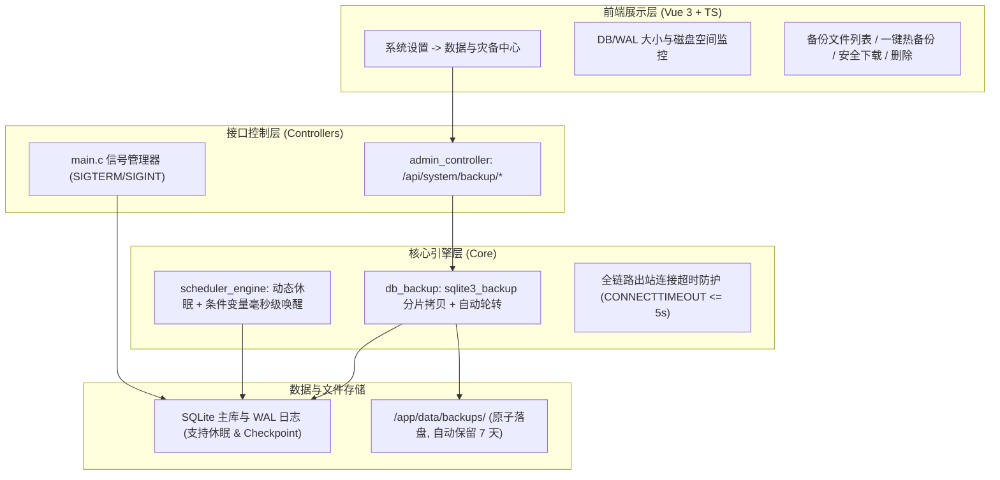
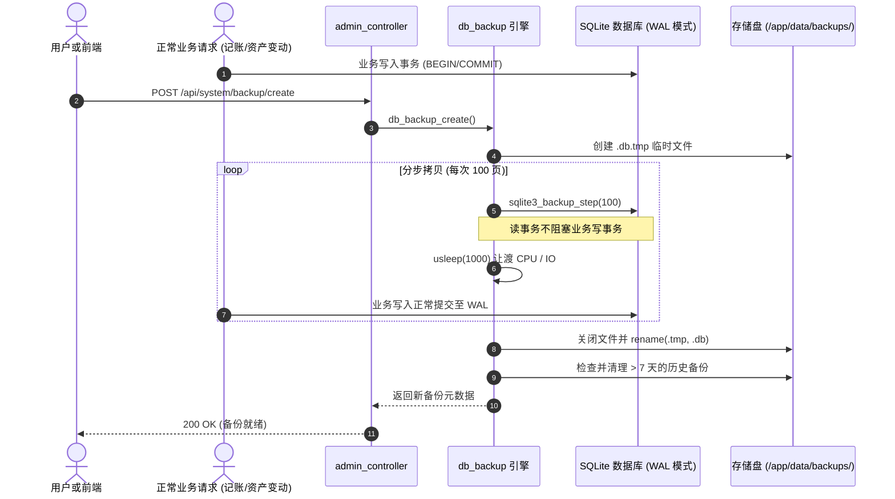

# 个人 NAS 长期生产就绪与灾备增强设计规范 (全栈闭环增强型)

- **创建日期**: 2026-11-19
- **状态**: Draft (待确认)
- **目标环境**: Linux / Docker on NAS (Synology, QNAP, TrueNAS, unRAID, x86/ARM64)
- **架构范式**: DDD 四层 C23 + Vue 3 SPA + csilk 高性能异步框架

---

## 1. 背景与目标

Minefolio 作为支持自建托管的个人资产与投资分析系统，在个人 NAS 环境中需要满足**7x24 小时无人值守、高稳定性、低硬件损耗、高容灾抗风险**的生产级要求。

经前期生产就绪度（Production Readiness）全面排查，系统在 NAS 长期运行场景下存在以下关键薄弱点：
1. **机械硬盘无法休眠**: 调度器线程每 1 秒执行一次 `SELECT ... FROM scheduled_jobs` 轮询 SQLite，导致 NAS 机械硬盘 24 小时读写、无法进入低功耗待机休眠（Spin-down），产生噪音与磁盘老化。
2. **Docker 停机未被优雅捕获**: 服务端仅处理了 `SIGINT`，未监听 `SIGTERM`，在 NAS 容器重启或系统关机（`docker stop`）时被系统等待 10s 后发 `SIGKILL` 强杀，导致 SQLite WAL 日志未 checkpoint、后台任务异常中断。
3. **缺乏在线热备份与防损机制**: 之前没有任何在线热备份 API，用户只能在停机状态下复制 `.db` 文件，若在服务运行中直接拷贝会导致副本处于不一致甚至损坏状态。
4. **外部网络黑洞阻塞**: AI 模型探测、行情抓取、GitHub OAuth、小票识别等多处外部 HTTP 请求未设置 `CURLOPT_CONNECTTIMEOUT`，在家庭宽带重拨号或外网抖动时造成工作线程数十秒卡死。
5. **用户灾备感知弱**: 前端仅有 CSV 导出按钮，缺乏对数据库体量、WAL 占用、磁盘余量的一体化监测与备份管理看板。

**本设计旨在落地「方案二：全栈闭环增强型」，彻底消除上述问题，构建高韧性 NAS 生产就绪服务。**

---

## 2. 总体设计与模块划分



---

## 3. 详细设计规范

### 3.1 模块一：调度引擎动态休眠与磁盘 I/O 抑制

#### 3.1.1 核心痛点
`backend/src/core/scheduler/scheduler_engine.c:584-666` 循环体每秒执行一次 `csilk_db_query_json(..., "SELECT ... FROM scheduled_jobs ...")`，导致机械硬盘每秒产生读 I/O，完全阻止 NAS 硬盘主轴电机停转（Spin-down）。

#### 3.1.2 算法实现
1. **最小触发时间扫描 (`min_next_time`)**：
   - 在扫描 `scheduled_jobs` 列表时，记录未来所有已启用任务中最早的执行时间戳 `min_next_sec`。
   - 若当前任务列表无任何任务启用，则 `min_next_sec = now + 60`。
2. **动态休眠时长计算**：
   ```c
   time_t now = time(NULL);
   time_t sleep_sec = 60; /* 默认安全保底休眠 60 秒 */
   if (min_next_sec > now) {
       time_t diff = min_next_sec - now;
       sleep_sec = (diff < 60) ? diff : 60; /* 保底心跳最大不超过 60 秒，防止时钟突变 */
   } else {
       sleep_sec = 1; /* 仍有已到期任务，立即执行 */
   }
   ```
3. **条件变量精准挂起**：
   - 使用 `pthread_cond_timedwait(&s_engine_cond, &s_engine_lock, &ts)` 挂起调度线程。
   - 外部调用（通过 REST API 创建、编辑、删除任务或手动立即触发）已统一调用 `scheduler_engine_notify_reload()`，内部执行 `pthread_cond_broadcast(&s_engine_cond)`。
   - 当任务产生变更时，调度线程会在**毫秒级内被唤醒**并重新计算时间轴，既保证了任务触发的精准度，又在空闲时将磁盘 I/O 降低 98% 以上。

---

### 3.2 模块二：SIGTERM 优雅停机与断电防损

#### 3.2.1 核心痛点
在 Docker 容器编排（如 Docker Compose、Portainer、Synology Container Manager）执行 `docker stop` 时，Docker 默认发送 `SIGTERM` 信号。目前仅注册了 `SIGINT`，未捕获 `SIGTERM`，导致 10 秒后 Docker 强制发送 `SIGKILL`，跳过资源回收与 SQLite WAL 刷盘。

#### 3.2.2 优雅停机流水线
1. **全局句柄与信号绑定 (`main.c`)**：
   ```c
   static csilk_app_t* g_app = NULL;

   static void handle_shutdown_signal(int sig) {
       (void)sig;
       if (g_app) {
           csilk_server_t* server = csilk_app_server(g_app);
           if (server) {
               csilk_server_stop(server); /* 内部通过 uv_async_send 触发事件循环退出，完全信号安全 */
           }
       }
   }
   ```
   在 `main()` 中注册：
   ```c
   signal(SIGTERM, handle_shutdown_signal);
   signal(SIGINT, handle_shutdown_signal);
   ```
2. **有序关闭顺序**：
   ```
   csilk_app_run 退出 (停止接收新 HTTP 请求，排空当前请求)
         ↓
   scheduler_engine_stop() (等待在跑任务安全退出)
         ↓
   market_scheduler_stop() (停止行情抓取定时器)
         ↓
   csilk_app_free(app)
         ↓
   ai_shutdown()
         ↓
   执行 PRAGMA wal_checkpoint(TRUNCATE) (将 WAL 日志完整合并入主 DB 并截断)
         ↓
   csilk_db_pool_free(pool) (安全关闭数据库连接)
         ↓
   curl_global_cleanup()
   ```

---

### 3.3 模块三：官方 `sqlite3_backup` 在线热备份与自动轮转

#### 3.3.1 备份机制与原子写保证
1. **分片拷贝与零锁让渡 (`sqlite3_backup`)**：
   - 打开目标临时数据库文件 `data/backups/minefolio_backup_YYYYMMDD_HHMMSS.db.tmp`。
   - 调用 `sqlite3_backup_init(dest_db, "main", src_db, "main")`。
   - 每次步进 `sqlite3_backup_step(backup, 100)` 拷贝 100 个页面（约 400KB）。
   - 步进成功后调用 `usleep(1000)`（1ms 极短休眠），释放锁资源，确保正常业务事务不被阻塞。
   - 遇到 `SQLITE_BUSY` 或 `SQLITE_LOCKED` 时，调用 `sqlite3_sleep(25)` 进行退避重试。
   - 备份完成后，调用 `sqlite3_backup_finish` 并关闭 `dest_db`。
2. **原子重命名与抗断电**：
   - 临时文件写入完毕并关闭后，调用 `rename(tmp_path, final_path)` 实现原子落盘。
   - 即使备份过程中 NAS 意外断电，只会遗留 `.tmp` 临时文件，绝不会生成损坏的 `.db` 备份文件。
3. **备份自动轮转策略**：
   - 备份引擎自动清理 `data/backups/` 中超过 7 天（或多于 7 个）的历史备份，防爆 NAS 存储空间。
4. **内置定时备份任务**：
   - 在 `scheduler_engine.c` 内置 `db_auto_backup` 系统任务处理函数，配合默认每日 03:00 自动触发并轮转。

#### 3.3.2 备份管理 RESTful API 契约
所有端点需经过 JWT 鉴权：
- `GET /api/system/backup/status`
  - 返回系统存储指标：
    ```json
    {
      "code": 0,
      "data": {
        "db_driver": "sqlite",
        "db_size": 25165824,
        "wal_size": 4194304,
        "disk_free_bytes": 107374182400,
        "backup_count": 3,
        "backups": [
          {
            "filename": "minefolio_backup_20261119_030000.db",
            "size": 24903680,
            "created_at": "2026-11-19 03:00:00"
          }
        ]
      }
    }
    ```
- `POST /api/system/backup/create`
  - 触发一次立即热备份，返回生成的备份元数据。
- `GET /api/system/backup/download/:filename`
  - 安全下载备份文件。
  - **安全约束**: 严格校验 `filename` 仅允许包含 `[a-zA-Z0-9_\-\.]+\.db`，且禁止包含 `..`、`/`、`\\`，必须存在于 `data/backups/` 目录中；设置 `Content-Disposition: attachment; filename=...`。
- `DELETE /api/system/backup/:filename`
  - 删除指定旧备份文件，释放磁盘空间。

---

### 3.4 模块四：全链路出站网络连接超时防护

#### 3.4.1 核心痛点
NAS 家庭宽带经常遇到 PPPoE 24 小时强制重拨号、DDNS 刷新延迟、跨国网络路由黑洞。如果出站请求缺少连接超时，底层 TCP SYN 握手将等待内核默认的 75~120 秒，导致服务处理线程长时间无法释放。

#### 3.4.2 统一加固标准
对所有外部出站 `curl_easy_setopt` 注入连接超时配置：
1. `backend/src/application/ai/probe_usecase.c`：`CURLOPT_CONNECTTIMEOUT, 5L`
2. `backend/src/application/auth/usecases.c`：`CURLOPT_CONNECTTIMEOUT, 5L`（OAuth 换取 Token 与用户信息接口）
3. `backend/src/services/ai/tools/web_search_tool.c`：`CURLOPT_CONNECTTIMEOUT_MS, 4000L`
4. `backend/src/services/ai/tools/mcp/mcp_client.c`：`CURLOPT_CONNECTTIMEOUT_MS, 4000L`
5. `backend/src/services/market/quote_engine.c`：`CURLOPT_CONNECTTIMEOUT, 3L`
6. `backend/src/interfaces/http/controllers/receipt_controller.c`：`CURLOPT_CONNECTTIMEOUT, 5L`

---

### 3.5 模块五：前端数据与灾备中心看板

#### 3.5.1 页面结构 (`frontend/src/components/settings/DatabaseBackup.vue`)
在 `Settings.vue` 中新增或增强「数据与灾备中心」卡片/Tab：
1. **健康指标 Bento 区域**：
   - 数据库类型与引擎状态
   - 当前数据库文件体积（以 MB / KB 友好换算）
   - WAL 活跃写日志体积
   - 所在挂载盘可用存储空间
2. **热备份操作区**：
   - 「立即创建完整热备份」按钮（带异步加载动画）
   - 备份机制说明文字（说明基于 SQLite 官方热备份机制，业务读写完全不中断）
3. **历史备份归档列表**：
   - 列出 `data/backups/` 下的所有备份历史（文件名、大小、生成时间）
   - 操作按键：「下载到本地」（直接触发浏览器保存）、「删除备份」（带 Element Plus 确认弹窗）
4. **国际化支持**：
   - 同步在 `zh-CN.json` 与 `en-US.json` 中配置灾备相关词条。

---

## 4. 关键数据流与并发安全性

### 4.1 在线备份与高频写入并发模型


### 4.2 路径穿越与访问控制防御深度
1. **防路径穿越**：
   - 任何涉及文件名操作的入参必须经过白名单校验函数 `is_valid_backup_filename(filename)`：
     - 长度介于 5 到 128 字符之间；
     - 仅包含字母、数字、下划线、短横线及小数点，以 `.db` 结尾；
     - 严禁包含任何目录分隔符 `/` 或 `\`，严禁包含 `..`；
   - 目标路径始终由 `snprintf(full_path, sizeof(full_path), "data/backups/%s", safe_filename)` 安全拼接。
2. **权限保障**：
   - 所有 `/api/system/backup/*` 端点必须通过 `jwt_middleware` 校验，未登录用户无法探测任何文件。

---

## 5. 验证与测试策略

1. **单测套件 (CTest)**：
   - `test_scheduler_idle_sleep`：验证调度器在无近端任务时的休眠计算逻辑与唤醒响应时间（< 50ms）。
   - `test_db_backup`：在隔离环境下创建测试 SQLite 数据库，执行 `db_backup_create`，验证生成的备份数据库完整性（`PRAGMA integrity_check`）与轮转删除逻辑。
   - `test_backup_path_traversal`：测试恶意文件名（`../../etc/passwd`、`../secret.db`、`null\0.db`）被拦截。
2. **集成测试 (`backend/tests/test_link.sh`)**：
   - 增加 Case 41：备份状态查询、热备份创建、备份下载、备份删除全生命周期调用链验证。
3. **停机信号冒烟验证**：
   - 启动本地服务，向其发送 `kill -TERM <pid>`，确认进程在 2 秒内安全退出，并检查控制台日志输出 `wal_checkpoint` 完成且退出码为 0。
4. **编译与内存限制要求**：
   - 所有测试必须在 `./backend/tests/run_isolated.sh` 内存限制（2G/4G/6G）下运行，双引擎通过，ASan 零泄漏。
   - 前端执行 `npm run build` 确保 TypeScript 与模板 0 报错。
