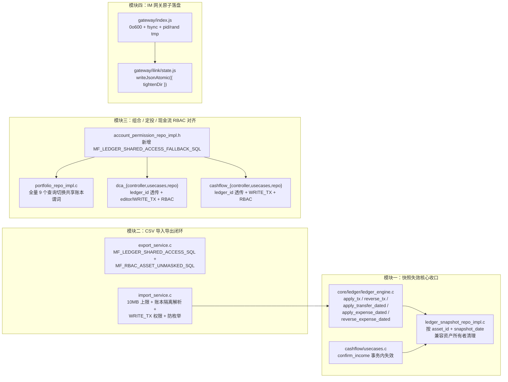

# Minefolio 安全权限收敛与账务一致性加固设计方案 (Design Spec)

**文档标识**: `2026-11-25-security-and-ledger-consistency-hardening-design`  
**创建时间**: 2026-11-25  
**基准提交**: `7d258b39`  
**状态**: 待评审 (Pending Review)  
**策略选型**: 方案 1 — 根因收敛与共享谓词复用（Root-Cause Hardening）

---

## 1. 背景与问题定义 (Intent & Scope)

基于 `7d258b39` 对全栈代码的系统性静态核查与链路追踪，系统虽已具备账户级/字段级 RBAC（V031）、多账本共享隔离以及检查点增量重建（V020），但在**跨模块边缘入口与后台持久化路径**仍存在 5 类实质性的安全越权与账务一致性缺陷：

1. **CSV 导出绕过 V031 账户 RBAC 且破坏共享账本读取**：
   - `backend/src/services/export_service.c` 中的 `transactions_export_csv()` 与 `daily_expenses_export_csv()` 已按 `ctx_ledger_id(c, user_id, "viewer")` 放行只读成员，但查询 SQL 未叠加 `MF_RBAC_ASSET_UNMASKED_SQL`，导致被设为 `permission_level='none'` 或 `mask_balance=1` 的受限账户可通过导出接口泄露明文记录与金额。
   - 两条导出 SQL 硬编码 `WHERE t.user_id=? AND t.ledger_id=?` / `WHERE de.user_id=? AND de.ledger_id=?`，未使用 `MF_LEDGER_SHARED_ACCESS_SQL`，导致共享账本成员无法导出账本所有者创建的流水。
2. **CSV 导入存在跨账本数据串改与账户写权限绕过**：
   - `backend/src/services/import_service.c` 中的 `transactions_import_csv_task_fn()` 与 `daily_expenses_import_csv_task_fn()` 按名称反查资产和分类时仅过滤 `WHERE user_id=? AND name=?`，缺少 `ledger_id` 作用域限定；多账本存在同名资产时，向账本 B 导入会误命中并改写账本 A 的资产余额，同时将流水落入账本 B。
   - 导入写入前未校验 `MF_ACCOUNT_ACTION_WRITE_TX`，账本 `editor` 可借导入绕过受限账户（`viewer` / `none`）的写保护；若填写了 `linked_asset_name` 但未查到资产，当前实现会静默将 `linked_id` 置 0 后继续入库，导致漏扣资金账户；上传入口 `submit_csv_import_task()` 也缺少明确体量上限。
3. **V020 账本检查点快照（`ledger_snapshots`）失效链路断裂**：
   - `ledger_snapshot_invalidate_from()` 目前仅在 `backend/src/application/transaction/usecases.c` 中被调用；`import_service.c`（交易/收支导入）、`application/dca/usecases.c`（定投确认买入）、`application/transfer/usecases.c`（划转）、`application/daily_expense/usecases.c`（日常收支增删改）及 `application/cashflow/usecases.c`（现金流收益确认）均未触发快照失效。凡补录或修改早于快照日期的记录，后续 `ledger_rebuild_*` 增量重建会读取过期检查点导致持仓失真。
   - `backend/src/infrastructure/repositories/ledger_snapshot_repo_impl.c` 中 `ledger_snapshot_invalidate_from()` 仅按 `WHERE user_id=? AND asset_id=? AND snapshot_date >= ?` 删除；共享账本 `editor`（`user_id=B`）操作所有者（`user_id=A`）名下资产时，会因 `user_id` 不匹配而漏清 A 的快照。
4. **投资组合、定投（DCA）与现金流（Cashflow）的共享账本及账户 RBAC 对齐缺失**：
   - `backend/src/infrastructure/repositories/portfolio_repo_impl.c` 全部 9 个查询函数虽已绑定 `MF_RBAC_ASSET_UNMASKED_SQL` / `MF_RBAC_ASSET_VISIBLE_SQL`，但在 `ledger_id > 0` 分支仍使用 `WHERE a.user_id=? AND a.ledger_id=?`（或 `t.user_id=?` / `abl.user_id=?`），导致共享账本成员查询驾驶舱/持仓/收益时读不到所有者数据。
   - `dca_plans` 与 `cashflow_schedules` 表结构已存在 `ledger_id` 列与索引，但写入 SQL 未插入 `ledger_id`、读接口未透传 `ledger_id` 且完全缺失共享账本成员可见性与账户级 RBAC 过滤；同时 `dca_controller.c` 的 `dca_service_confirm_execution()` / `dca_service_skip_execution()` 缺失 `editor` 角色与账户写权限校验，`cashflow_usecase_delete_schedule()` 缺失目标账户写权限校验。
5. **传统 IM 网关凭证落盘权限与原子性薄弱**：
   - `gateway/index.js` 中的 `saveCache()` 将明文 `im_bind` JWT 写入 `im_bindings.json` 时未强制 `0o600` 文件权限，未执行 `fsyncSync`，且临时文件后缀仅依赖 `Date.now()`（同毫秒并发写易冲突）。

### 1.1 已确认的业务语义边界

1. **CSV 导出遇 `mask_balance=1` 账户**：采用**整行排除**（统一使用 `MF_RBAC_ASSET_UNMASKED_SQL` 同时排除 `none` 与 `mask_balance=1`），与报表汇总口径一致，同时保证导出的 CSV 为纯数值格式可直接二次导入。
2. **DCA / Cashflow 多账本与共享账本隔离**：采用**零迁移方案**，不新增 `V036` 数据库迁移脚本；新记录写入时落库 `ledger_id`，查询时通过 `COALESCE(NULLIF(alias.ledger_id, 0), asset_alias.ledger_id)` 无缝兼容历史 `NULL` / `0` 行，并严格校验关联双资产同属当前账本。
3. **CSV 导入遇无写权限行**：采用**逐行拒绝 + 防探测策略**——`permission_level='none'` 隐藏账户在名称解析阶段即过滤，统一报 `第N行: 找不到资产 'xxx'` 防枚举；可见但只读（`viewer`）账户逐行报 `第N行: 账户无记账权限`，其余合法行正常导入。

### 1.2 非目标 (Non-Goals)

- 不新增数据库 DDL 迁移版本（无 `V036`）。
- 不把 `export_service.c` / `import_service.c` 拆迁重构为 DDD `application` / `infrastructure` 仓储（保留在后续架构边界专题处理）。
- 不改造报表层 `double` 聚合为 `decimal_t`，也不处理 `migration.sql` 与 `V034`/`V035` 的基准同步（保留在精度与 Schema 门禁专题处理）。
- 不涉及前端与移动端离线同步代码改动（保留在端侧治理专题处理）。

---

## 2. 总体架构与分模块设计 (Architecture & Detailed Design)



---

### 2.1 模块一：账本检查点快照（V020）失效链路收口

#### 2.1.1 共享账本下的快照所有者清理
**变更文件**：`backend/src/infrastructure/repositories/ledger_snapshot_repo_impl.c`

将 `ledger_snapshot_invalidate_from()` 的删除 SQL 从仅匹配 `user_id = ?` 升级为同时兼容调用者与资产所有者（保留参数化绑定与纵深防御，避免共享账本 `editor` 操作所有者资产时漏清所有者快照）：

```sql
DELETE FROM ledger_snapshots
WHERE asset_id = ?
  AND snapshot_date >= ?
  AND (user_id = ? OR user_id = (SELECT user_id FROM assets WHERE id = ?))
```

- 绑定参数顺序（4 个）：`[ast_str, from_day, uid_str, ast_str]`。
- 前置校验不变：`!pool || user_id <= 0 || asset_id <= 0 || !from_date || strlen(from_date) < 10` 时返回 `-1`；`from_day` 截断为 `%.10s`（`YYYY-MM-DD`）。
- SQLite 与 PostgreSQL 通用，无需方言分支。

#### 2.1.2 账本引擎全入口内置失效
**变更文件**：`backend/src/core/ledger/ledger_engine.h`、`backend/src/core/ledger/ledger_engine.c`

在 `ledger_engine.c` 中引入 `infrastructure/repositories/ledger_snapshot_repo_impl.h`（与同层 `ledger_rebuild.c` 依赖方式一致，不破坏单向分层约束）。新增文件内辅助函数 `invalidate_asset_snapshot_safe(pool, user_id, asset_id, date_str)`：
- 若 `asset_id <= 0`，直接返回 `0`；
- 若 `date_str` 为空或长度不足 10 字符，自动回退为当天日期 `YYYY-MM-DD`；
- 调用 `ledger_snapshot_invalidate_from(pool, user_id, asset_id, effective_day)`，返回非 0 视为失败。

各数据库事务算子统一在 `db_tx_scope_commit` 之前执行快照失效，失败时回滚整个 `scope` 并返回 `-1`：
1. `ledger_apply_tx(pool, tx)`：在提交前对 `tx->asset_id` 与 `tx->linked_asset_id` 按 `effective_date` 失效快照。覆盖范围：**交易创建/更新、CSV 交易导入、DCA 定投买入确认**。
2. `ledger_reverse_tx(pool, user_id, tx_id)`：在提交前对 `old_tx` 的 `asset_id` 与 `linked_asset_id` 按 `rev_date` 失效快照。覆盖范围：**交易更新冲正、交易删除**。
3. 新增日期感知转账与收支接口（原无日期函数保留为兼容包装，内部以当天 `YYYY-MM-DD` 委托至 `*_dated` 版本）：
   - `int ledger_apply_transfer_dated(csilk_db_pool_t* pool, int64_t user_id, int64_t from_asset_id, int64_t to_asset_id, money_t amount, int64_t transfer_id, const char* note, const char* transfer_date);`（提交前失效 `from_asset_id` 与 `to_asset_id`）
   - `int ledger_apply_expense_dated(csilk_db_pool_t* pool, int64_t user_id, int64_t asset_id, money_t amount, int is_income, int64_t expense_id, const char* note, const char* expense_date);`（提交前失效 `asset_id`）
   - `int ledger_reverse_expense_dated(csilk_db_pool_t* pool, int64_t user_id, int64_t asset_id, money_t amount, int is_income, int64_t expense_id, const char* note, const char* expense_date);`（提交前失效 `asset_id`）

#### 2.1.3 上层业务用例对齐
- `backend/src/application/transfer/usecases.c`：`transfer_usecase_create()` 改调 `ledger_apply_transfer_dated(..., cmd->transfer_date)`。
- `backend/src/application/daily_expense/usecases.c`：`apply_balance()` 与 `reverse_balance()` 增加 `const char* expense_date` 参数并改调 `ledger_apply_expense_dated()` / `ledger_reverse_expense_dated()`；更新日常收支时，旧记录按 `old.expense_date` 回滚、新记录按 `cmd->expense_date` 入账，确保切换资产或改期时新旧两侧资产均失效快照。
- `backend/src/application/cashflow/usecases.c`：`cashflow_usecase_confirm_income()` 保持“仅贷记 `target_asset_id`、不扣减 `source_asset_id`、保留 `source_asset_id` 作为 `linked_asset_id`”的既定语义；确保插入的 `transactions` 行正确归属当前 `ledger_id`（优先取 `target_asset_id` 所属账本，缺失时使用 `cmd->ledger_id`），并在 `db_tx_scope_commit` 前调用 `ledger_snapshot_invalidate_from(db_pool, cmd->user_id, cmd->target_asset_id, full_date)`，返回非 0 时回滚事务。
- `backend/src/application/transaction/usecases.c`：移除与 `ledger_apply_tx` / `ledger_reverse_tx` 重复的外层 `ledger_snapshot_invalidate_from()` 调用，避免同一事务内重复执行无谓的 `DELETE`。

---

### 2.2 模块二：CSV 导出与导入安全闭环

#### 2.2.1 CSV 导出（`backend/src/services/export_service.c`）
引入 `infrastructure/repositories/account_permission_repo_impl.h`，在已有的 `ctx_ledger_id(c, user_id, "viewer")` 校验基础上改写两条导出 SQL：

1. **交易记录导出（`transactions_export_csv()`）**：
   ```sql
   SELECT t.transaction_date, t.transaction_type, t.source_type, t.amount,
          t.price_per_unit, t.quantity, t.fee, t.currency, t.note,
          a.name as asset_name, la.name as linked_asset_name, c.name as category_name
   FROM transactions t
   LEFT JOIN assets a ON t.asset_id=a.id
   LEFT JOIN assets la ON t.linked_asset_id=la.id
   LEFT JOIN categories c ON t.category_id=c.id
   WHERE MF_LEDGER_SHARED_ACCESS_SQL("t")
     AND MF_RBAC_ASSET_UNMASKED_SQL("a")
     AND MF_RBAC_ASSET_UNMASKED_SQL("la")
   ORDER BY t.transaction_date DESC, t.id DESC
   ```
   - 绑定参数（8 个）：`[lid_str, uid_str, uid_str, uid_str, uid_str, uid_str, uid_str, uid_str]`。
   - 若交易关联的主资产 `a` 或资金资产 `la` 任一方对当前用户为 `permission_level='none'` 或 `mask_balance=1`，整行排除；`linked_asset_id` 为空时 `la.account_id IS NULL` 自动放行。

2. **日常收支导出（`daily_expenses_export_csv()`）**：
   ```sql
   SELECT de.expense_date, de.expense_type, de.amount, de.currency, de.note,
          a.name as asset_name, c.name as category_name
   FROM daily_expenses de
   LEFT JOIN assets a ON de.asset_id=a.id
   LEFT JOIN categories c ON de.category_id=c.id
   WHERE MF_LEDGER_SHARED_ACCESS_SQL("de")
     AND MF_RBAC_ASSET_UNMASKED_SQL("a")
   ORDER BY de.expense_date DESC, de.id DESC
   ```
   - 绑定参数（6 个）：`[lid_str, uid_str, uid_str, uid_str, uid_str, uid_str]`。
   - 共享账本成员可正常导出账本所有者录入的非脱敏/非隐藏流水；未绑定资产的记账（`a.account_id IS NULL`）不受影响。

#### 2.2.2 CSV 导入（`backend/src/services/import_service.c`）
引入 `infrastructure/repositories/account_permission_repo_impl.h` 与 `application/account/usecases.h`，在保留逐行解析与部分成功模式的同时，补齐 5 道安全与一致性护栏：

1. **上传体积硬上限**：`submit_csv_import_task()` 定义 `MF_MAX_CSV_IMPORT_BYTES`（`10 * 1024 * 1024`），在 `malloc` 之前校验 `csv_len > MF_MAX_CSV_IMPORT_BYTES`，超限返回 `respond_bad_request(c, "CSV 文件大小不能超过 10MB")`。
2. **账本隔离 + 防探测名称解析**：
   - 新增内部辅助函数 `resolve_import_asset(pool, user_id, ledger_id, name, &out_asset_id, &out_account_id)`：
     ```sql
     SELECT a.id, COALESCE(a.account_id, 0) AS account_id
     FROM assets a
     WHERE a.name = ?
       AND MF_LEDGER_SHARED_ACCESS_SQL("a")
       AND MF_RBAC_ASSET_VISIBLE_SQL("a")
     ORDER BY a.id ASC LIMIT 1
     ```
     绑定参数（7 个）：`[name, lid_str, uid_str, uid_str, uid_str, uid_str, uid_str]`。
     隐藏账户（`permission_level='none'`）或其它账本同名资产在查询期即被排除，统一向用户返回 `第N行: 找不到资产 'xxx'`，消除隐藏资产名探测风险。
   - 新增内部辅助函数 `resolve_import_category(pool, user_id, ledger_id, name)`：
     ```sql
     SELECT c.id
     FROM categories c
     WHERE c.name = ?
       AND MF_LEDGER_SHARED_ACCESS_SQL("c")
     ORDER BY c.id ASC LIMIT 1
     ```
     绑定参数（5 个）：`[name, lid_str, uid_str, uid_str, uid_str]`，防止跨账本误绑分类；智能分类规则 `mf_import_rule_list()` 命中的 `category_id` 同样需通过查询 `categories` 验证其属于当前账本（`MF_LEDGER_SHARED_ACCESS_SQL("c")`），不匹配时忽略该规则并回退，避免跨账本写入。
3. **关联资金资产严格校验（交易导入）**：当 CSV 中 `linked_s` 非空时调用 `resolve_import_asset()`；若找不到对应可见资产，不再静默将 `linked_id = 0` 入库，而是记录 `第N行: 找不到关联资产 'xxx'` 并跳过当前行。
4. **账户级写权限守门（`MF_ACCOUNT_ACTION_WRITE_TX`）**：
   - 在执行 `ledger_apply_tx()` 或写入 `daily_expenses` 前，对主资产调用 `account_usecase_check_permission(pool, ledger_id, user_id, asset_account_id, MF_ACCOUNT_ACTION_WRITE_TX)`；交易导入若存在 `linked_id > 0` 再校验 `linked_account_id`。
   - 任一账户返回非 0（如 `viewer` 只读账户），逐行拒绝并记入 `第N行: 账户无记账权限`（或 `第N行: 关联账户无记账权限`），跳过该行继续处理后续行。
5. **与快照失效联动**：`daily_expenses_import_csv_task_fn()` 在调用入账余额更新时改调 `ledger_apply_expense_dated(pool, user_id, asset_id, amt_m, is_income, expense_id, note_s ? note_s : "", date_s)`（`transactions_import_csv_task_fn()` 通过 `ledger_apply_tx()` 已内置失效）。

---

### 2.3 模块三：组合、定投、现金流的共享账本与账户 RBAC 对齐

#### 2.3.1 新增兼容历史 `NULL`/`0` `ledger_id` 的共享账本 SQL 宏
**变更文件**：`backend/src/infrastructure/repositories/account_permission_repo_impl.h`

在现有谓词体系旁新增 `MF_LEDGER_SHARED_ACCESS_FALLBACK_SQL(alias, asset_alias)`，用于 `dca_plans` 与 `cashflow_schedules` 等历史未强制落库 `ledger_id` 的业务表（绑定 4 个参数 `[ledger_id, user_id, user_id, user_id]`，SQLite / PostgreSQL 通用）：

```c
#define MF_LEDGER_SHARED_ACCESS_FALLBACK_SQL(alias, asset_alias)                                   \
    "(COALESCE(NULLIF(" alias ".ledger_id, 0), " asset_alias ".ledger_id) = ? AND ("               \
    alias ".user_id = ? OR EXISTS (SELECT 1 FROM ledgers _l WHERE _l.id = "                        \
    "COALESCE(NULLIF(" alias ".ledger_id, 0), " asset_alias ".ledger_id) AND _l.owner_id = ?) "     \
    "OR EXISTS (SELECT 1 FROM ledger_members _lm WHERE _lm.ledger_id = "                          \
    "COALESCE(NULLIF(" alias ".ledger_id, 0), " asset_alias ".ledger_id) AND _lm.user_id = ?)))"
```

同时抽取共享账本可写归属判定逻辑（与 `transaction_repo_impl.c` 口径一致：记录创建者或对应账本的 `owner` / `editor` 成员允许执行修改/删除）。

#### 2.3.2 投资组合仓储全量切换共享账本（`backend/src/infrastructure/repositories/portfolio_repo_impl.c`）
`report_controller.c` 已向 `portfolio_usecase_*` 透传 `ledger_id`，**全部 9 个仓储函数签名保持不变**，仅修正 `ledger_id > 0` 分支 SQL：

| 函数名 | 现有隔离缺陷 | 修复后 `ledger_id > 0` 谓词 |
|---|---|---|
| `mf_portfolio_repo_get_holdings` | `a.user_id = ? AND a.ledger_id = ?` | `MF_LEDGER_SHARED_ACCESS_SQL("a") AND MF_RBAC_ASSET_UNMASKED_SQL("a")` |
| `mf_portfolio_repo_get_trade_events` | `t.user_id = ? AND (t.ledger_id = ? OR a.ledger_id = ?)` | `MF_LEDGER_SHARED_ACCESS_FALLBACK_SQL("t", "a") AND MF_RBAC_ASSET_UNMASKED_SQL("a")` |
| `portfolio_repo_get_category_assets` | `a.user_id=? AND a.ledger_id=?` | `MF_LEDGER_SHARED_ACCESS_SQL("a") AND MF_RBAC_ASSET_UNMASKED_SQL("a")` |
| `portfolio_repo_get_liability_assets` | `a.user_id=? AND a.ledger_id=?` | `MF_LEDGER_SHARED_ACCESS_SQL("a") AND MF_RBAC_ASSET_UNMASKED_SQL("a")` |
| `portfolio_repo_get_recent_transactions` | `t.user_id=? AND (t.ledger_id=? OR a.ledger_id=?)` | `MF_LEDGER_SHARED_ACCESS_FALLBACK_SQL("t", "a") AND MF_RBAC_ASSET_VISIBLE_SQL("a") AND MF_RBAC_ASSET_VISIBLE_SQL("la")` |
| `portfolio_repo_get_trend_assets` | `a.user_id=? AND a.ledger_id=?` | `MF_LEDGER_SHARED_ACCESS_SQL("a") AND MF_RBAC_ASSET_UNMASKED_SQL("a")` |
| `portfolio_repo_get_trend_balance_logs` | `abl.user_id=? AND a.ledger_id=?` | `MF_LEDGER_SHARED_BALANCE_LOG_SQL("abl", "a") AND MF_RBAC_ASSET_UNMASKED_SQL("a")` |
| `portfolio_repo_get_performance_transactions` | `t.user_id=? AND (t.ledger_id=? OR a.ledger_id=?)` | `MF_LEDGER_SHARED_ACCESS_FALLBACK_SQL("t", "a") AND MF_RBAC_ASSET_UNMASKED_SQL("a")` |
| `portfolio_repo_get_holdings_raw` | `a.user_id=? AND a.ledger_id=?` | `MF_LEDGER_SHARED_ACCESS_SQL("a") AND MF_RBAC_ASSET_UNMASKED_SQL("a")` |

- 所有函数 `ledger_id <= 0` 分支保留原有 `user_id = ?` 个人兼容语义（供底层单元测试与单用户默认模式继续使用）。
- `params` 数组容量需确保充裕（`MF_LEDGER_SHARED_ACCESS_*` 需 4 个参数，加上 1～2 个 `MF_RBAC_ASSET_*` 各 2 个参数及 `MF_RBAC_MASK_BALANCE_COL` 参数，例如 `portfolio_repo_get_recent_transactions` 共需 13 个绑定参数，`params[20]` 充裕；其余函数扩大至 `params[16]` 并确保 `snprintf` 缓冲区 ≥ 1536 字节防截断）。

#### 2.3.3 定投计划（DCA）全链路补齐
**涉及文件**：
- `backend/src/domain/dca/entity.h`、`backend/src/domain/dca/repository.h`
- `backend/src/application/dca/commands.h`、`backend/src/application/dca/usecases.h`、`backend/src/application/dca/usecases.c`
- `backend/src/infrastructure/repositories/dca_repo_impl.c`
- `backend/src/interfaces/http/controllers/dca_controller.c`

具体改造要点：
1. **结构体字段扩展**：`mf_dca_plan_t`、`create_dca_plan_cmd_t`、`update_dca_plan_cmd_t`、`confirm_dca_execution_cmd_t` 统一增加 `int64_t ledger_id`。
2. **Controller 层全覆盖鉴权与透传**：
   - 5 个读接口（`dca_service_list_plans`、`dca_service_plan_summary`、`dca_service_get_plan`、`dca_service_list_executions`、`dca_service_list_pending_executions`）补齐 `ctx_ledger_id(c, user_id, "viewer")` 并透传至用例层。
   - 6 个写接口统一执行 `ctx_ledger_id(c, user_id, "editor")`，**特别修复 `dca_service_confirm_execution()` 与 `dca_service_skip_execution()` 原先缺失 `editor` 角色门禁的漏洞**；同时将 `ledger_id` 透传至 `set_plan_status`、`delete_plan`、`confirm_execution`、`skip_execution`。
3. **Application 用例层护栏**：
   - `dca_validate_asset_perm()` 新增 `int64_t req_ledger_id` 校验：若资产所属 `alid > 0 && req_ledger_id > 0 && alid != req_ledger_id`，返回 `1004`（`Forbidden: 不支持跨账本操作`）；并通过 `account_usecase_check_permission(..., MF_ACCOUNT_ACTION_WRITE_TX)`。
   - `dca_usecase_create_plan()` / `dca_usecase_update_plan()`：确定并校验 `target_asset_id` 与 `funding_asset_id` 同账本（若二者均有有效 `ledger_id` 且不等则返回 `1004`），将生效 `ledger_id` 写入 `plan.ledger_id`。
   - `dca_usecase_set_plan_status()` / `dca_usecase_delete_plan()`：操作前先经 `mf_dca_repo_plan_get(..., user_id, ledger_id, id)` 取出关联 `target_asset_id` 与 `funding_asset_id`，对双资产执行 `MF_ACCOUNT_ACTION_WRITE_TX` 校验；无权返回 `1004`，不存在返回 `1003`。
   - `dca_usecase_confirm_execution()` & `dca_usecase_skip_execution()`：读取执行详情前透传 `ledger_id`，**在执行扣款或标记跳过前对 `target_asset_id` 与 `funding_asset_id` 校验 `MF_ACCOUNT_ACTION_WRITE_TX`**；确认买入构造 `ledger_tx_t` 时显式填充 `.ledger_id`（取计划/资产账本 ID）。
4. **Repository SQL 升级**：
   - `mf_dca_repo_plan_create()` 的 `INSERT` 语句显式包含 `ledger_id` 列（`plan->ledger_id > 0` 时写入，否则取 `COALESCE((SELECT ledger_id FROM assets WHERE id=?), 0)`）。
   - `mf_dca_repo_plan_list()`、`mf_dca_repo_plan_summary()`、`mf_dca_repo_plan_get()`、`mf_dca_repo_execution_list_by_plan()`、`mf_dca_repo_execution_list_pending()`、`mf_dca_repo_execution_get()` 新增 `int64_t ledger_id` 参数：
     - 当 `ledger_id > 0` 时应用 `MF_LEDGER_SHARED_ACCESS_FALLBACK_SQL("p", "ta")`；当 `ledger_id <= 0` 时保持 `p.user_id = ?` 兼容旧单测。
     - 列表（含 `count_sql` 与数据查询均需 `JOIN assets ta` / `JOIN assets fa` 以保证 `out_total` 一致）、详情与执行记录叠加 `MF_RBAC_ASSET_VISIBLE_SQL("ta") AND MF_RBAC_ASSET_VISIBLE_SQL("fa")`；同时在 `plan_list` / `plan_get` 中通过 `MF_RBAC_MASK_BALANCE_COL("ta")` 对开启金额脱敏的目标资产将 `target_current_value`、`target_cost_basis`、`target_quantity` 脱敏归零并标记 `is_balance_masked=true`。`mf_dca_repo_plan_summary()` 聚合查询叠加 `MF_RBAC_ASSET_UNMASKED_SQL("ta") AND MF_RBAC_ASSET_UNMASKED_SQL("fa")` 防止脱敏账户余额通过总和反推。
   - `mf_dca_repo_plan_update()`、`mf_dca_repo_plan_set_status()`、`mf_dca_repo_plan_delete()`、`mf_dca_repo_execution_update_status()` 增加 `ledger_id` 上下文校验，允许共享账本 `owner`/`editor` 操作同账本记录（通过 `EXISTS (SELECT 1 FROM ledgers / ledger_members ... role IN ('owner','editor'))`）。
   - **调度器零破坏**：`mf_dca_repo_plan_list_all_active()` 与 `mf_dca_repo_execution_create()` 保持原有签名与后台调度行为不变。

#### 2.3.4 现金流排期（Cashflow）全链路补齐
**涉及文件**：
- `backend/src/domain/cashflow/entity.h`、`backend/src/domain/cashflow/repository.h`
- `backend/src/application/cashflow/commands.h`、`backend/src/application/cashflow/usecases.h`、`backend/src/application/cashflow/usecases.c`
- `backend/src/infrastructure/repositories/cashflow_repo_impl.h`、`backend/src/infrastructure/repositories/cashflow_repo_impl.c`
- `backend/src/interfaces/http/controllers/cashflow_controller.c`

具体改造要点：
1. **结构体字段扩展**：`mf_cashflow_schedule_t`、`create_cashflow_cmd_t`、`update_cashflow_cmd_t`、`confirm_cashflow_cmd_t`、`query_calendar_cmd_t` 统一增加 `int64_t ledger_id`。
2. **Controller 层补齐与透传**：
   - `api_cashflow_list_schedules()`、`api_cashflow_get_schedule()`、`api_cashflow_get_calendar()` 补齐 `ctx_ledger_id(c, user_id, "viewer")` 并透传 `ledger_id`。
   - `api_cashflow_create_schedule()`、`api_cashflow_update_schedule()`、`api_cashflow_delete_schedule()`、`api_cashflow_confirm()` 将已经解析的 `ledger_id` 正式写入命令并传递给用例（修复原先 `ledger_id` 查出后被丢弃的问题）。
3. **Application 用例层护栏**：
   - `cashflow_validate_asset_perm()` 新增 `int64_t req_ledger_id` 校验，拦截跨账本资产绑定（`1004`）。
   - `cashflow_usecase_create_schedule()` / `cashflow_usecase_update_schedule()`：校验 `source_asset_id` 与 `target_asset_id` 同属当前账本并将生效 `ledger_id` 写入 `s.ledger_id`。
   - `cashflow_usecase_delete_schedule(pool, user_id, ledger_id, id, out_res)`：删除前先查询排期详情，对 `target_asset_id` 校验 `MF_ACCOUNT_ACTION_WRITE_TX`（`source_asset_id` 若存在校验 `MF_ACCOUNT_ACTION_READ`），防止只读账户所属排期被 `editor` 误删。
4. **Repository SQL 升级**：
   - `SQL_SCHEDULE_CREATE` 显式写入 `ledger_id` 列；`parse_schedule_row()` 回填 `out->ledger_id`。
   - `mf_cashflow_repo_list()`、`mf_cashflow_repo_get()`、`mf_cashflow_repo_list_active()`、`cashflow_repo_list_detailed()`、`cashflow_repo_get_detailed()` 增加 `int64_t ledger_id` 参数；`ledger_id > 0` 时使用 `MF_LEDGER_SHARED_ACCESS_FALLBACK_SQL("s", "ta")`，`ledger_id <= 0` 保留 `s.user_id = ?`；所有查询统一叠加 `MF_RBAC_ASSET_VISIBLE_SQL("sa") AND MF_RBAC_ASSET_VISIBLE_SQL("ta")`。
   - `mf_cashflow_repo_get_actual_events()` 增加 `int64_t ledger_id` 参数；`ledger_id > 0` 时使用 `MF_LEDGER_SHARED_ACCESS_FALLBACK_SQL("t", "a")`，统一叠加 `MF_RBAC_ASSET_UNMASKED_SQL("a")`（日历实际汇总金额排除脱敏与隐藏账户，与总览口径一致）。
   - `mf_cashflow_repo_update()` 与 `mf_cashflow_repo_delete()` 归属谓词兼容共享账本 `owner`/`editor`。

---

### 2.4 模块四：传统 IM 网关凭证落盘加固

**涉及文件**：`gateway/ilink/state.js`、`gateway/index.js`

1. **复用原子落盘原语（`gateway/ilink/state.js`）**：
   - 调整 `writeJsonAtomic(filePath, data, opts = {})`，解构 `const { tightenDir = true } = opts;`。
   - 当 `tightenDir === true`（默认值，iLink 实例目录使用方式零变化）时，保持 `fs.mkdirSync(dir, { recursive: true, mode: 0o700 })` 与 `fs.chmodSync(dir, 0o700)`；
   - 当 `tightenDir === false`（用于 `gateway/index.js` 写入共享父目录下的 `im_bindings.json`）时，仅在 `!fs.existsSync(dir)` 时创建目录，不对既有父目录执行 `chmodSync(0o700)`，避免意外收紧项目目录或 `/tmp` 权限。
   - 保持临时文件规则不变：`${filePath}.tmp.${process.pid}.${crypto.randomBytes(4).toString('hex')}`、`fs.openSync(tmp, 'w', 0o600)`、`writeFileSync`、`fsyncSync`、`closeSync`、`renameSync`、`chmodSync(filePath, 0o600)`。

2. **收紧 `im_bindings.json` 读写（`gateway/index.js`）**：
   - `saveCache()` 改为直接调用 `writeJsonAtomic(CACHE_FILE, obj, { tightenDir: false })`，一次性消除同毫秒临时文件冲突、无 `fsync` 与 `0o644` 弱权限问题。
   - `loadCache()` 加载存量 `CACHE_FILE` 时，若文件存在则 best-effort 执行 `try { fs.chmodSync(CACHE_FILE, 0o600); } catch {}`，使升级后既有部署的存量文件也自动收紧为仅属主可读写。

---

## 3. 验证策略与回归测试矩阵 (Verification Plan)

所有后端构建与测试均通过工程约定方式执行（`backend/build` / `backend/build-asan`，或通过隔离执行入口运行），并在修改完成后跑通全量检验：

| 维度 | 测试目标 / 脚本 | 核心断言覆盖 |
|---|---|---|
| **快照失效回归** | `backend/tests/unit/test_ledger_rebuild_checkpoint.c` | ① 已有快照后通过 `ledger_apply_tx`（含模拟 DCA/CSV 补录）、`ledger_reverse_tx`、`ledger_apply_transfer_dated`、`ledger_apply_expense_dated`、`ledger_reverse_expense_dated`、`cashflow_usecase_confirm_income` 插入/删除历史日记录，验证对应日及之后快照被清理而更早快照保留；② 共享账本 `editor` 修改所有者资产交易时，验证所有者的历史快照被正确清理；③ 模拟异常参数/失效失败时事务整体回滚不残留脏快照 |
| **RBAC 与共享账本回归** | `backend/tests/unit/test_account_rbac.c` | ① 共享账本 `viewer`/`editor` 调用 `portfolio_repo_*` 全部 9 个接口可读取所有者未脱敏数据，并严格过滤 `none`/`mask_balance=1` 账户；② 共享成员访问 `dca` / `cashflow` 读写接口：历史 `ledger_id=NULL` 兼容读取、跨账本资产绑定返回 `1004`、`viewer` 账户拒绝写入/确认/跳过/删除并返回 `1004`、汇总与实际事件排除 `mask_balance=1`；③ CSV 导出：`viewer` 可导出共享账本明文且整行排除 `none`/`mask_balance=1` 账户；④ CSV 导入：多账本同名资产隔离不串改他账本、`none` 账户报 `找不到资产`（不泄密）、`viewer` 账户逐行拒绝并继续导入合法行、不存在的 `linked_asset_name` 拒绝入库且不漏扣资金、超 10MB 拒绝返回 400 |
| **仓储契约回归** | `backend/tests/unit/test_domain_repositories.c` | 适配 `mf_dca_repo_*` / `mf_cashflow_repo_*` 新增 `ledger_id` 参数，覆盖 `ledger_id=0` 兼容模式与 `ledger_id>0` 账本隔离模式 |
| **全量单测与 ASan** | `ctest --test-dir backend/build --output-on-failure` 与 ASan 构建测试 | 全部 84+ 个 CTest 单测全绿，AddressSanitizer / UBSan 零泄漏零越界 |
| **集成测试（SQLite & PG）** | `backend/tests/test_link.sh`、`backend/tests/test_dca_cashflow.sh` | 覆盖双数据库引擎 SQL 兼容性（特别是 `COALESCE(NULLIF(...,0),...)` 与共享账本谓词）与 HTTP 端到端回归 |
| **Gateway 单测** | `gateway/adapters/test/cache.test.js`、`npm --prefix gateway test` | 校验 `saveCache()` 后 `im_bindings.json` 文件权限掩码 `mode & 0o777 === 0o600`、目录权限未被修改、并发/连续写入无 `.tmp.*` 残留且内容完整、`loadCache()` 自动收紧存量 `0o644` 文件权限 |

---

## 4. 影响文件清单 (Affected Files)

| 层级 | 文件路径 | 变更概要 |
|---|---|---|
| **Core / Ledger** | `backend/src/core/ledger/ledger_engine.h`<br>`backend/src/core/ledger/ledger_engine.c` | 引擎内收口快照失效，新增 `*_dated` 转账与收支入口 |
| **Infrastructure** | `backend/src/infrastructure/repositories/ledger_snapshot_repo_impl.c`<br>`backend/src/infrastructure/repositories/account_permission_repo_impl.h`<br>`backend/src/infrastructure/repositories/portfolio_repo_impl.c`<br>`backend/src/infrastructure/repositories/dca_repo_impl.c`<br>`backend/src/infrastructure/repositories/cashflow_repo_impl.h`<br>`backend/src/infrastructure/repositories/cashflow_repo_impl.c` | 修复快照所有者失效；新增回退共享宏；全量切换组合共享查询；补齐 DCA/Cashflow 账本与 RBAC SQL |
| **Domain** | `backend/src/domain/dca/entity.h`<br>`backend/src/domain/dca/repository.h`<br>`backend/src/domain/cashflow/entity.h`<br>`backend/src/domain/cashflow/repository.h` | 补齐 `ledger_id` 实体字段与仓储查询参数 |
| **Application** | `backend/src/application/transaction/usecases.c`<br>`backend/src/application/transfer/usecases.c`<br>`backend/src/application/daily_expense/usecases.c`<br>`backend/src/application/dca/{commands,usecases}.h/.c`<br>`backend/src/application/cashflow/{commands,usecases}.h/.c` | 收口调用 `*_dated`/移除重复失效；补齐 `ledger_id` 透传、同账本校验与 `WRITE_TX` 校验；`confirm_income` 补齐快照失效与 `ledger_id` |
| **Services** | `backend/src/services/export_service.c`<br>`backend/src/services/import_service.c` | 导出叠加工行级 RBAC 与共享账本；导入补 10MB 限流、账本隔离、防探测、`WRITE_TX` 守门与快照失效 |
| **Interfaces** | `backend/src/interfaces/http/controllers/dca_controller.c`<br>`backend/src/interfaces/http/controllers/cashflow_controller.c` | 全量读写接口补齐 `ctx_ledger_id(..., viewer/editor)` 校验与 `ledger_id` 透传 |
| **Gateway** | `gateway/ilink/state.js`<br>`gateway/index.js` | `writeJsonAtomic` 支持 `tightenDir`；`saveCache`/`loadCache` 原子化并锁定 `0o600` |
| **Tests** | `backend/tests/unit/test_ledger_rebuild_checkpoint.c`<br>`backend/tests/unit/test_account_rbac.c`<br>`backend/tests/unit/test_domain_repositories.c`<br>`gateway/adapters/test/cache.test.js` | 补全快照失效、RBAC 隔离、跨账本导出导入、DCA/Cashflow 回归与网关权限测试 |
